# Bancada didática CFW500

Bancada didática em 3D para **ligar, parametrizar e operar o inversor WEG CFW500** como na prática: você arrasta os componentes, passa os fios de borne a borne, mede com o multímetro e opera pela HMI do inversor. Não tem CLP nem rede.

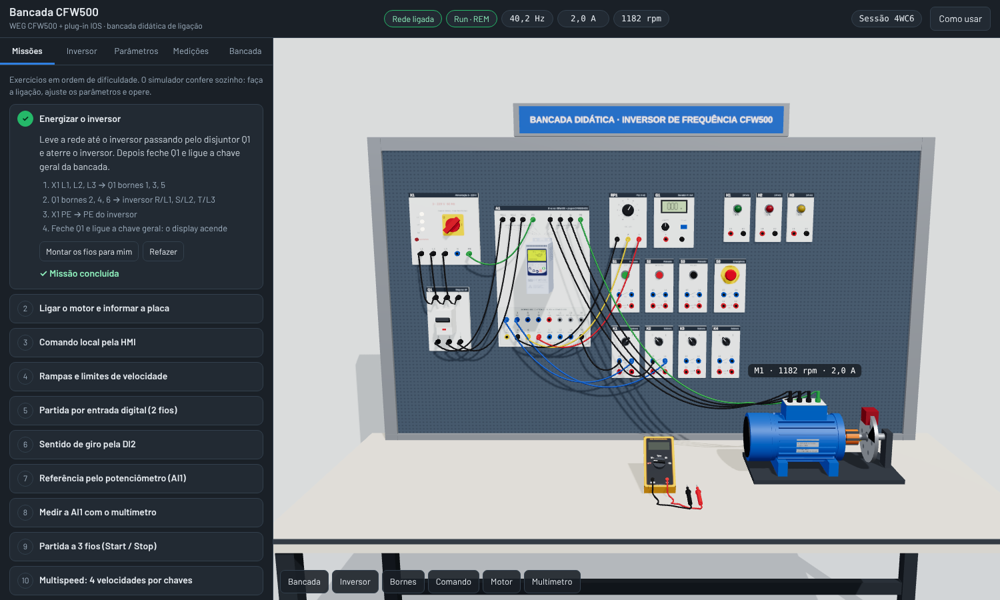

## 1. Para quem é

Para quem vai aprender ou ensinar a instalação do inversor: força, comando por entradas digitais, entrada analógica, multispeed, saídas digitais e diagnóstico. O simulador não pede nome nem cadastro: abre e está pronto para treinar. Cada aluno trabalha na sua própria bancada (sessões independentes, seção 3).

| Equipamento simulado | Dado |
|---|---|
| Inversor | WEG CFW500A04P3B2: 200-240 V, 4,3 A, mecânica A, alimentação monofásica ou trifásica |
| Plug-in | CFW500-IOS: 4 DIs, 1 AI, 1 AO, 1 relé, 1 transistor, RS-485 |
| Firmware de referência | V3.9X (Manual de Programação 10006739493/09) |
| Motor | WEG W22 IR3 Premium, 0,75 kW (1 cv), 4 polos, ligado em triângulo 220 V, 2,98 A, 1725 rpm, cos φ 0,80, rendimento 82,6 % |
| Rede da bancada | Trifásica 220 V entre fases, 127 V fase-neutro, 60 Hz |

## 2. A tela

| Como fazer | Ação |
|---|---|
| Passar um fio | Clique num borne e depois no outro, ou arraste de um borne ao outro. Esc cancela. |
| Tirar um fio | Clique no fio e no botão **Remover fio** (ou tecla Delete). Duplo clique ou botão direito no fio também tira. |
| Arrumar um fio | O cabo é maleável: pende entre os plugues, deita na mesa e contorna o inversor e o motor. Arraste qualquer ponto do fio para puxar; ao soltar, o ponto fica preso numa presilha. Arraste a presilha para mudar; duplo clique ou botão direito nela solta o cabo. |
| Mover um componente | Arraste pela placa; os cabos ligados acompanham. O motor e o multímetro andam sobre a mesa. |
| Acionar | Clique na chave geral, na alavanca do disjuntor, nas chaves seletoras e no cogumelo. Segure os botões pulsadores e as teclas do inversor. Arraste o botão do potenciômetro (ou use a roda do mouse sobre ele). |
| Multímetro | Clique no seletor para trocar a função. Arraste cada ponta até o borne, ou toque na ponta e depois no borne. |
| Câmera | Arraste o fundo para girar; botão direito ou dois dedos para deslocar; roda do mouse ou pinça para aproximar. Os botões embaixo levam a cada parte. |
| Explicação de um componente | Botão direito nele (em tela de toque, um toque rápido). |

As cinco abas da lateral:

| Aba | Para que serve |
|---|---|
| Missões | A trilha de exercícios. O simulador confere sozinho e marca ✓. "Montar os fios para mim" faz a ligação da missão; "Ver parâmetros" mostra a resposta. |
| Inversor | A HMI em tamanho grande, o estado (P0006), a explicação da falha, do alarme ou do CONF e as leituras principais. |
| Parâmetros | A lista completa com busca e filtro por grupo. Clique no valor para alterar. |
| Medições | O multímetro em tamanho grande e o que o inversor enxerga em cada entrada e saída. |
| Bancada | Cor do fio, montagens prontas, componentes extras, freio de carga, volante de inércia, chave S1.1 do plug-in e o registro de acontecimentos. |

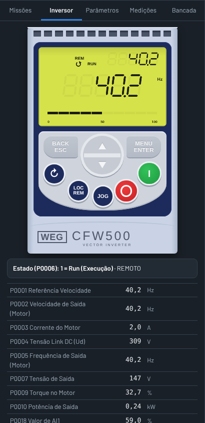 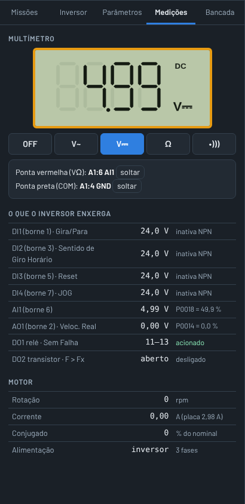

## 3. Sessões independentes

Cada aba do navegador é uma **sessão**: uma bancada completa e separada, com os seus componentes, fios, parâmetros do inversor e missões. Vários alunos usam ao mesmo tempo sem um mexer na bancada do outro.

| Situação | O que acontece |
|---|---|
| Cada aluno no seu PC, abrindo a bancada do PC do instrutor pela rede | Cada navegador tem a sua sessão. O servidor só entrega a tela: não há limite de alunos nem bancada compartilhada |
| Dois alunos no mesmo PC | Uma aba para cada um: a segunda aba recebe outra sessão, em branco |
| Recarregar a página (F5) | A aba continua na mesma sessão, com tudo o que estava montado. A chave geral volta desligada |
| Fechar e abrir de novo | A aba nova continua a última bancada que não estiver aberta em outra aba |
| Aba duplicada, ou pedir uma sessão que já está aberta | A aba recebe uma sessão nova e avisa: uma bancada nunca fica dividida entre duas abas |

O código da sessão (quatro letras e números, por exemplo `C3BD`) aparece no topo da tela. Clicando nele abre a lista das sessões guardadas neste navegador, com os botões **Abrir aqui**, **Apagar** e **Nova sessão em branco nesta aba**. Para abrir direto numa sessão, use o endereço com `?sessao=C3BD`.

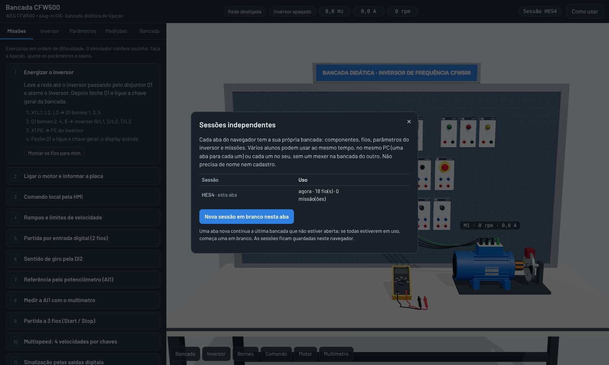

As sessões ficam guardadas no navegador de cada um (não no servidor). O simulador mantém as 12 mais recentes e apaga as que ficaram mais de 60 dias sem uso. O botão **Restaurar original** do HUB apaga as sessões do navegador em que for usado.

## 4. Os componentes da bancada

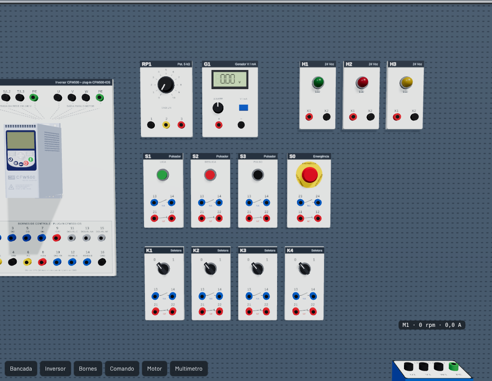

| Tag | Componente | Bornes |
|---|---|---|
| X1 | Alimentação trifásica 220 V | L1, L2, L3, N, PE |
| Q1 | Disjuntor tripolar | 1, 3, 5, 2, 4, 6 |
| A1 | Inversor CFW500 + plug-in CFW500-IOS | R/L1, S/L2, T/L3, PE, U, V, W, PE, 1 DI1, 3 DI2, 5 DI3, 7 DI4, 9 +24V, 11 DO1-RL-C, 13 DO1-RL-NA, 15 DO1-RL-NF, 2 AO1, 4 GND, 6 AI1, 8 +10V, 10 DO2-TR, 12 RS485-A, 14 RS485-B, 16 GND |
| RP1 | Potenciômetro 5 kΩ | 1, 2, 3 |
| G1 | Gerador de sinal 0-10 V / 4-20 mA | +, − |
| H1 | Sinaleiro 24 Vcc verde | X1, X2 |
| H2 | Sinaleiro 24 Vcc vermelho | X1, X2 |
| H3 | Sinaleiro 24 Vcc amarelo | X1, X2 |
| S1 | Botão pulsador verde | 13, 14, 21, 22 |
| S2 | Botão pulsador vermelho | 13, 14, 21, 22 |
| S3 | Botão pulsador preto | 13, 14, 21, 22 |
| S0 | Botão de emergência | 23, 24, 11, 12 |
| K1 | Chave seletora 2 posições | 13, 14, 21, 22 |
| K2 | Chave seletora 2 posições | 13, 14, 21, 22 |
| K3 | Chave seletora 2 posições | 13, 14, 21, 22 |
| K4 | Chave seletora 2 posições | 13, 14, 21, 22 |
| M1 | Motor trifásico 1 cv | U1, V1, W1, PE |
| P1 | Multímetro digital | pontas VΩ e COM |

Botões e chaves têm sempre um contato **NA** (azul) e um **NF** (vermelho). Pela aba Bancada dá para acrescentar mais botões, chaves, sinaleiros, potenciômetro, disjuntor e gerador de sinal.

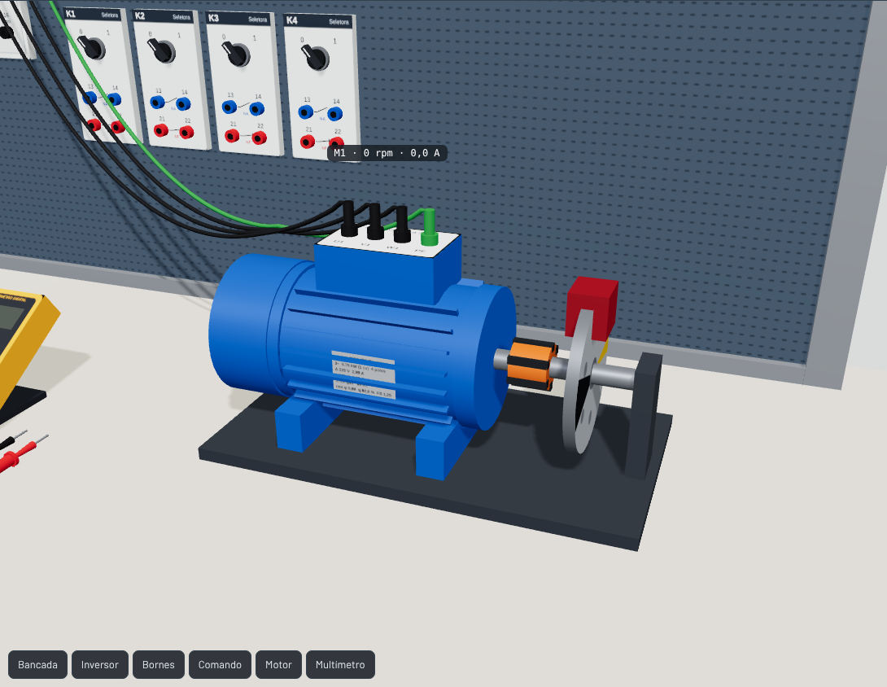

## 5. Os bornes do CFW500

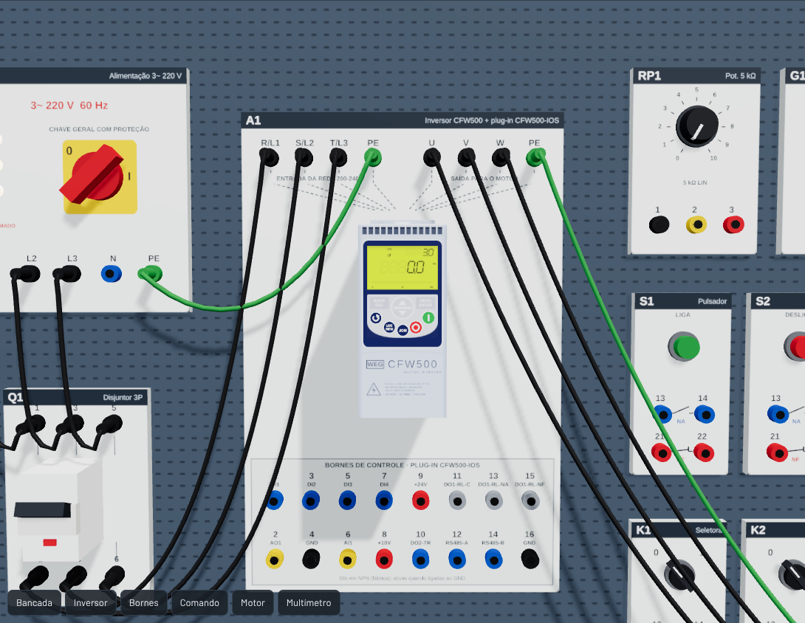

Força: **R/L1, S/L2, T/L3** recebem a rede (este modelo aceita duas ou três fases de 220 V) e **U, V, W** vão ao motor. Os dois **PE** são o terra.

Controle (plug-in CFW500-IOS), com a mesma numeração do produto:

| Borne | Nome | Função |
|---|---|---|
| 1 | DI1 | Entrada digital 1 |
| 3 | DI2 | Entrada digital 2 |
| 5 | DI3 | Entrada digital 3 |
| 7 | DI4 | Entrada digital 4 |
| 9 | +24V | Fonte +24 Vcc (máx. 150 mA) |
| 11 | DO1-RL-C | Relé DO1: comum |
| 13 | DO1-RL-NA | Relé DO1: contato NA |
| 15 | DO1-RL-NF | Relé DO1: contato NF |
| 2 | AO1 | Saída analógica 1 (0-10 V) |
| 4 | GND | Referência 0 V |
| 6 | AI1 | Entrada analógica 1 |
| 8 | +10V | Referência +10 Vcc para potenciômetro |
| 10 | DO2-TR | Saída digital 2 (transistor NPN, coletor aberto) |
| 12 | RS485-A | RS-485 (terminal A) |
| 14 | RS485-B | RS-485 (terminal B) |
| 16 | GND | Referência 0 V |

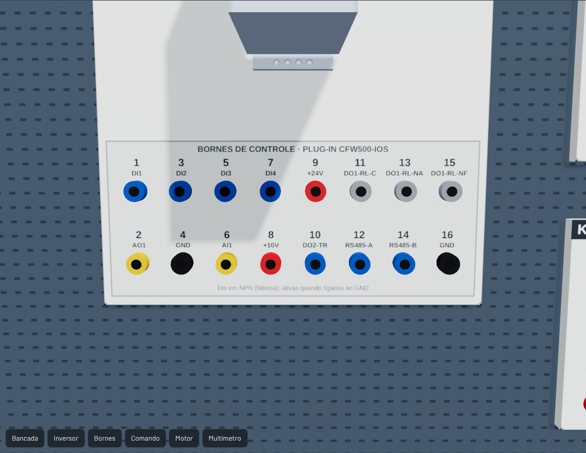

Três pontos que derrubam o iniciante:

1. **As DIs de fábrica são NPN** (P0271 = 0): ficam ativas quando ligadas ao **GND** (borne 4 ou 16), não ao +24 V. Aberta, a DI fica em 24 V; fechada ao GND, vai a 0 V.
2. **De fábrica o inversor liga em LOCAL**: quem manda são as teclas da HMI. As DIs e a AI1 só valem em REMOTO (tecla LOC/REM).
3. **Rede em U, V, W destrói o inversor.** Na bancada isso desarma a proteção e a tela diz o motivo.

## 6. A HMI do inversor

| Tecla | Função |
|---|---|
| I | Gira (quando o Gira/Para está nas teclas: LOCAL de fábrica) |
| O | Para. Com falha no display, faz o reset |
| ↻ | Inverte o sentido de giro |
| LOC/REM | Troca entre LOCAL e REMOTO |
| JOG | Com o motor parado, gira em P0122 enquanto apertada |
| ▲ ▼ | Na monitoração ajustam a referência (P0121). Nos menus escolhem grupo, parâmetro e valor. Segurando, aceleram |
| ENTER/MENU | Entra no próximo nível e grava o valor |
| BACK/ESC | Volta um nível sem gravar |

Para alterar um parâmetro (exemplo: P0100 para 3,0 s):

1. **ENTER/MENU**: acende o grupo PARAM (▲▼ trocam de grupo: READ, MODIF, BASIC, MOTOR, I/O, NET, HMI, SPLC, STARTUP).
2. **ENTER/MENU**: o display principal mostra o número do parâmetro e o secundário, o conteúdo. Use ▲▼ até **P0100**.
3. **ENTER/MENU**: o conteúdo vai para o display principal e pisca. Use ▼ até **3.0**.
4. **ENTER/MENU** grava. **BACK/ESC** duas vezes volta à monitoração.

Parâmetros marcados **cfg** só mudam com o motor parado. Com senha ativa (P0200 = 1) é preciso colocar a senha em P0000 (fábrica: 5).

## 7. Parâmetros mais usados na bancada

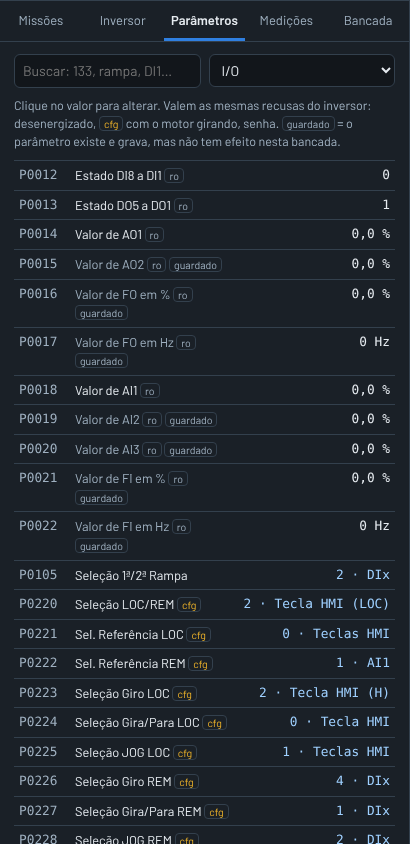

| Parâmetro | Nome | Fábrica | Para que serve |
|---|---|---|---|
| P0100 | Tempo Aceleração | 10,0 s | Tempo de 0 até a velocidade máxima |
| P0101 | Tempo Desaceleração | 10,0 s | Tempo da velocidade máxima até 0 |
| P0121 | Referência via HMI | 3,0 Hz | Referência ajustada pelas setas |
| P0133 | Velocidade Mínima | 3,0 Hz | Menor frequência com o motor girando |
| P0134 | Velocidade Máxima | 66,0 Hz | Maior frequência |
| P0135 | Corrente Máxima Saída | 6,5 A | Limite de corrente: segura a rampa |
| P0136 | Boost de Torque Manual | 3,0 % | Tensão extra em baixa frequência (curva V/f) |
| P0202 | Tipo de Controle | 0 (V/f) | 0 = V/f, 5 = VVW |
| P0204 | Carrega/Salva Parâm. | 0 (Sem Função) | 5 = volta tudo ao padrão de fábrica |
| P0220 | Seleção LOC/REM | 2 (Tecla HMI (LOC)) | Quem escolhe LOCAL ou REMOTO |
| P0221 | Sel. Referência LOC | 0 (Teclas HMI) | De onde vem a referência em LOCAL |
| P0222 | Sel. Referência REM | 1 (AI1) | De onde vem a referência em REMOTO |
| P0223 | Seleção Giro LOC | 2 (Tecla HMI (H)) | Sentido de giro em LOCAL |
| P0226 | Seleção Giro REM | 4 (DIx) | Sentido de giro em REMOTO |
| P0224 | Seleção Gira/Para LOC | 0 (Tecla HMI) | Gira/Para em LOCAL |
| P0227 | Seleção Gira/Para REM | 1 (DIx) | Gira/Para em REMOTO |
| P0229 | Seleção Modo Parada | 0 (Por Rampa) | Como para: rampa, inércia ou parada rápida |
| P0230 | Zona Morta (AIs) | 0 (Inativa) | Zona morta da entrada analógica |
| P0233 | Sinal da Entrada AI1 | 0 (0 a 10 V / 20 mA) | Tipo de sinal da AI1 |
| P0251 | Função da Saída AO1 | 2 (Veloc. Real) | O que a AO1 mostra |
| P0263 | Função da Entrada DI1 | 1 (Gira/Para) | Função da DI1 |
| P0264 | Função da Entrada DI2 | 8 (Sentido de Giro Horário) | Função da DI2 |
| P0265 | Função da Entrada DI3 | 20 (Reset) | Função da DI3 |
| P0266 | Função da Entrada DI4 | 10 (JOG) | Função da DI4 |
| P0271 | Sinal das DIs | 0 ((DI1...DI8) NPN) | DIs em NPN ou PNP |
| P0275 | Função da Saída DO1 | 13 (Sem Falha) | Função do relé DO1 |
| P0276 | Função da Saída DO2 | 2 (F > Fx) | Função do transistor DO2 |
| P0288 | Velocidade Fx | 3,0 Hz | Nível de frequência para F > Fx |
| P0401 | Corrente Nom. Motor | 4,3 A | Corrente de placa do motor |
| P0402 | Rotação Nom. Motor | 1710 rpm | Rotação de placa |
| P0404 | Potência Nom. Motor | 5 (1,00 HP (0,75 kW)) | Potência de placa |

Os valores "conforme o modelo do inversor" do manual foram fixados para o modelo de 4,3 A: P0135 = 6,5 A, P0156 = 4,7 A, P0157 = 4,3 A, P0158 = 3,4 A, P0290 = 4,3 A, P0401 = 4,3 A, P0404 = 1 HP. P0136 = 3,0 % e P0409 = 3,50 Ω seguem o simulador CFW500 do HUB.

## 8. Trilha de exercícios

### 1. Energizar o inversor

Leve a rede até o inversor passando pelo disjuntor Q1 e aterre o inversor. Depois feche Q1 e ligue a chave geral da bancada.

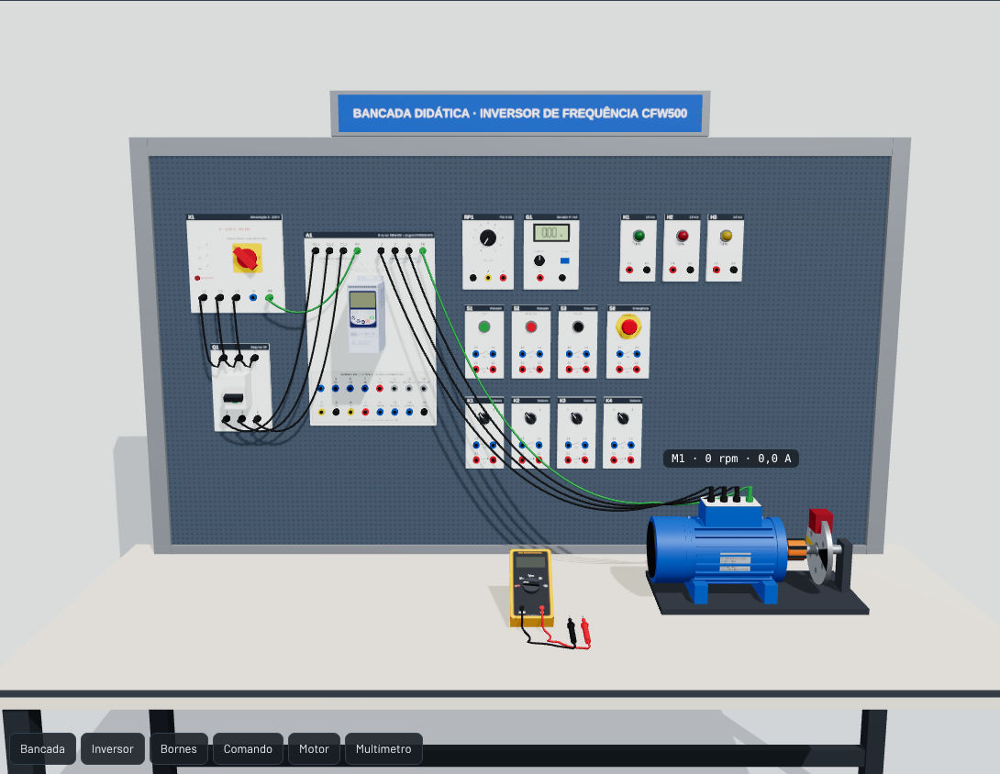

Passo a passo:

1. X1 L1, L2, L3 → Q1 bornes 1, 3, 5
2. Q1 bornes 2, 4, 6 → inversor R/L1, S/L2, T/L3
3. X1 PE → PE do inversor
4. Feche Q1 e ligue a chave geral: o display acende

**O que observar:** O display acende, passa cerca de 1,5 s inicializando e mostra a monitoração. P0004 (link DC) fica perto de **311 V**. Com o multímetro em V~: **220 V** entre R e S e **127 V** entre fase e neutro. Se ligar só uma fase e o neutro (127 V), o inversor acende mas fica em **SUB** (subtensão, link DC em 179 V).

### 2. Ligar o motor e informar a placa

Ligue U, V, W e PE do inversor ao motor. Leia a placa do motor (clique nele com o botão direito) e grave os dados no grupo MOTOR.

Passo a passo:

1. U → U1, V → V1, W → W1 e PE → PE
2. P0401 = 3,0 A (placa: 2,98 A)
3. P0402 = 1725 rpm · P0403 = 60 Hz
4. P0404 = 5 (1 HP / 0,75 kW)
5. P0399 = 82,6 % · P0407 = 0,80

| Parâmetro | Nome | Ajuste |
|---|---|---|
| P0401 | Corrente Nom. Motor | 3,0 A |
| P0402 | Rotação Nom. Motor | 1725 rpm |
| P0403 | Frequência Nom. Motor | 60 Hz |
| P0404 | Potência Nom. Motor | 5 (1,00 HP (0,75 kW)) |
| P0399 | Rendimento Nom. Motor | 82,6 % |
| P0407 | Fator Pot. Nom. Motor | 0,80 |

**O que observar:** A placa do motor aparece clicando nele com o botão direito. P0401 tem uma casa decimal: 2,98 A vira 3,0 A. Estes dados alimentam a proteção de sobrecarga (P0156 a P0158 continuam os de fábrica) e o controle VVW.

### 3. Comando local pela HMI

Em modo LOCAL (fábrica), gire o motor pela tecla I, leve a referência a 30,0 Hz com as setas, inverta o sentido pela tecla de giro e pare com a tecla O.

Passo a passo:

1. Tecla I: o motor parte na velocidade mínima (P0133)
2. Setas ▲▼ na tela de monitoração: 30,0 Hz
3. Tecla de sentido de giro: desacelera, inverte e volta a 30 Hz
4. Tecla O: para por rampa

**O que observar:** Com 30 % de carga no freio: em 30 Hz o motor gira a cerca de **875 rpm** com **110 V** na saída; em 60 Hz, **1776 rpm**, **220 V** e **2,0 A**. Na inversão a seta de sentido pisca enquanto o motor desacelera e muda de lado.

### 4. Rampas e limites de velocidade

Ajuste aceleração de 3 s, desaceleração de 5 s, mínima de 5 Hz e máxima de 60 Hz. Depois acelere até a máxima e confira no display.

Passo a passo:

1. P0100 = 3,0 s · P0101 = 5,0 s
2. P0133 = 5,0 Hz · P0134 = 60,0 Hz
3. Gire e suba a referência até travar em 60,0 Hz

| Parâmetro | Nome | Ajuste |
|---|---|---|
| P0100 | Tempo Aceleração | 3,0 s |
| P0101 | Tempo Desaceleração | 5,0 s |
| P0133 | Velocidade Mínima | 5,0 Hz |
| P0134 | Velocidade Máxima | 60,0 Hz |

**O que observar:** O tempo de rampa vale de zero até a velocidade máxima (P0134). Com P0134 = 60 Hz e P0100 = 3 s, sair de 5 Hz e chegar em 60 Hz leva 2,75 s.

### 5. Partida por entrada digital (2 fios)

Use a chave K1 para ligar e desligar pela DI1. De fábrica as DIs são NPN: ativam quando ligadas ao GND. Passe para REMOTO pela tecla LOC/REM e deixe a referência do remoto na HMI.

Passo a passo:

1. GND (borne 16) → K1 13 · K1 14 → DI1 (borne 1)
2. P0222 = 0 (referência REM pelas teclas da HMI)
3. Tecla LOC/REM: aparece REM no display
4. K1 ligada: gira · K1 desligada: para por rampa

| Parâmetro | Nome | Ajuste |
|---|---|---|
| P0222 | Sel. Referência REM | 0 (Teclas HMI) |

**O que observar:** Meça com o multímetro em V⎓ entre a DI1 (borne 1) e o GND: **24 V** com a chave aberta e **0 V** com ela fechada. É assim que uma entrada NPN enxerga o comando. A aba Medições mostra a mesma coisa para as quatro DIs.

### 6. Sentido de giro pela DI2

Com o motor girando em REMOTO, use a chave K2 na DI2 (função de fábrica: sentido de giro) para inverter a rotação.

Passo a passo:

1. GND → K2 13 · K2 14 → DI2 (borne 3)
2. K1 ligada: gira no sentido horário
3. K2 ligada: desacelera, inverte e acelera no anti-horário

| Parâmetro | Nome | Ajuste |
|---|---|---|
| P0222 | Sel. Referência REM | 0 (Teclas HMI) |

**O que observar:** A função de fábrica da DI2 é o sentido de giro: aberta = horário, fechada = anti-horário. O inversor desacelera pela rampa, passa por zero e acelera no outro sentido.

### 7. Referência pelo potenciômetro (AI1)

Ligue o potenciômetro: +10 V no extremo 3, cursor na AI1 e extremo 1 no GND. Com P0222 = 1 (fábrica) a velocidade no REMOTO acompanha o botão.

Passo a passo:

1. +10 V (borne 8) → RP1 3
2. AI1 (borne 6) → RP1 2 (cursor)
3. GND (borne 4) → RP1 1
4. P0222 = 1 · REM · K1 ligada
5. Gire o potenciômetro do mínimo ao máximo e veja P0018 e a frequência

| Parâmetro | Nome | Ajuste |
|---|---|---|
| P0222 | Sel. Referência REM | 1 (AI1) |

**O que observar:** Valores medidos na bancada (P0133 = 3 Hz, P0134 = 66 Hz): no mínimo **3,0 Hz**; no meio **4,92 V**, P0018 = **49,2 %** e **34,0 Hz**; no máximo **9,96 V**, **99,6 %** e **65,7 Hz**. O meio não dá 5,00 V porque a AI1 (100 kΩ) carrega o cursor do potenciômetro. Com a zona morta inativa (P0230 = 0) a referência vai de P0133 a P0134.

### 8. Medir a AI1 com o multímetro

Ponha o multímetro em V⎓, a ponta vermelha na AI1 (borne 6) e a preta no GND (borne 4). Ajuste o potenciômetro até ler 5,00 V e compare com P0018 (50 %).

Passo a passo:

1. Seletor do multímetro em V⎓
2. Ponta vermelha no borne 6 (AI1) · ponta preta no borne 4 (GND)
3. Gire o potenciômetro até 5,00 V (± 0,10 V)

**O que observar:** Compare o que o multímetro lê com P0018: 5,00 V = 50,0 %. Aproveite para medir a AO1 (borne 2): de fábrica ela repete a velocidade real, **10 V em 66 Hz** (5,15 V em 34 Hz).

### 9. Partida a 3 fios (Start / Stop)

Botão verde S1 (contato NA) dá a partida com um pulso e o vermelho S2 (contato NF) para. Programe DI1 = Start e DI2 = Stop. Se aparecer CONF, falta programar uma das duas.

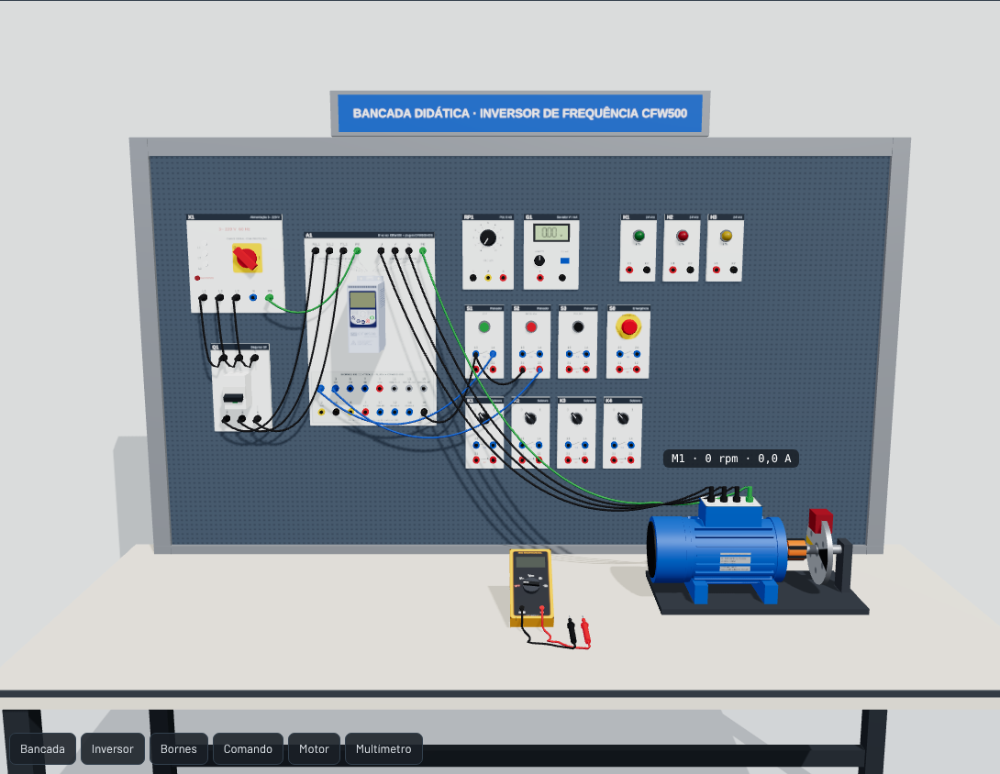

Passo a passo:

1. GND → S1 13 · S1 14 → DI1
2. GND → S2 21 · S2 22 → DI2 (contato NF: fio partido = motor parado)
3. P0263 = 6 (Start) · P0264 = 7 (Stop)
4. P0226 = 0 (sentido horário fixo no REM) · P0222 = 0
5. REM · pulso em S1: gira e continua · pulso em S2: para

| Parâmetro | Nome | Ajuste |
|---|---|---|
| P0263 | Função da Entrada DI1 | 6 (Start) |
| P0264 | Função da Entrada DI2 | 7 (Stop) |
| P0222 | Sel. Referência REM | 0 (Teclas HMI) |
| P0226 | Seleção Giro REM | 0 (Horário) |

**O que observar:** O contato do Stop é NF de propósito: se o fio partir, o motor para. Segurar o S1 não muda nada depois da partida: o Start só age na borda de subida.

### 10. Multispeed: 4 velocidades por chaves

K1 liga o motor (DI1) e as chaves K3 (DI3) e K4 (DI4) escolhem a velocidade: 10, 20, 40 e 60 Hz. DI4 é o bit menos significativo.

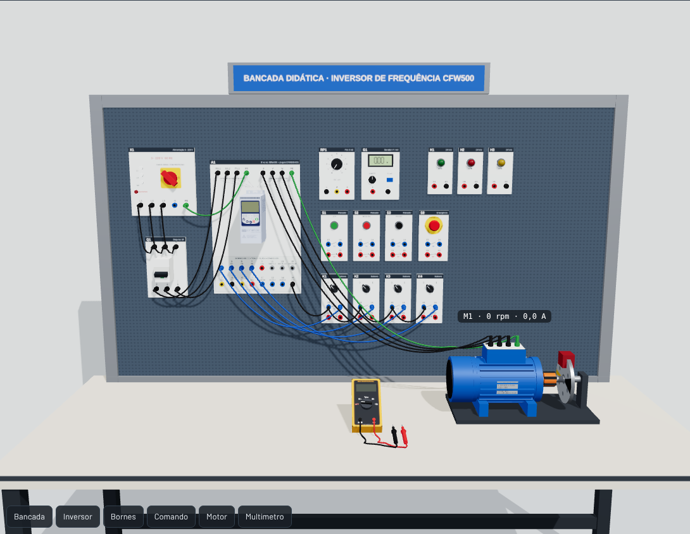

Passo a passo:

1. K1 → DI1 · K3 → DI3 · K4 → DI4 (todas com o comum no GND)
2. P0222 = 8 (Multispeed) · P0265 = 13 · P0266 = 13 · P0264 = 0 · P0226 = 0
3. P0124 = 10 · P0125 = 20 · P0126 = 40 · P0127 = 60 Hz
4. REM · K1 ligada · passe pelas 4 combinações de K3 e K4

| Parâmetro | Nome | Ajuste |
|---|---|---|
| P0222 | Sel. Referência REM | 8 (Multispeed) |
| P0264 | Função da Entrada DI2 | 0 (Sem Função) |
| P0265 | Função da Entrada DI3 | 13 (Multispeed) |
| P0266 | Função da Entrada DI4 | 13 (Multispeed) |
| P0226 | Seleção Giro REM | 0 (Horário) |
| P0124 | Ref. 1 Multispeed | 10,0 Hz |
| P0125 | Ref. 2 Multispeed | 20,0 Hz |
| P0126 | Ref. 3 Multispeed | 40,0 Hz |
| P0127 | Ref. 4 Multispeed | 60,0 Hz |
| P0134 | Velocidade Máxima | 66,0 Hz |

**O que observar:** DI4 é o bit menos significativo, DI3 o do meio e DI1 ou DI2 o mais significativo (aqui não usado, então só as quatro primeiras referências aparecem). Se programar P0222 = 8 sem nenhuma DI em Multispeed, o inversor entra em **CONF 17**.

### 11. Sinalização pelas saídas digitais

O relé DO1 acende o sinaleiro verde H1 enquanto o motor gira (Run) e o transistor DO2 acende o amarelo H3 acima de 30 Hz (F > Fx).

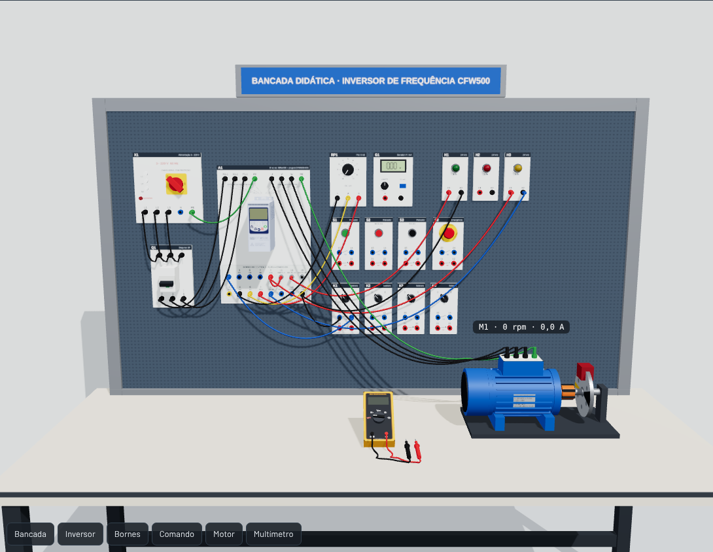

Passo a passo:

1. +24 V (9) → DO1-RL-C (11) · DO1-RL-NA (13) → H1 X1 · H1 X2 → GND (16)
2. +24 V (9) → H3 X1 · H3 X2 → DO2-TR (10): o transistor fecha para o GND
3. P0275 = 11 (Run) · P0276 = 2 (F > Fx) · P0288 = 30,0 Hz
4. Gire abaixo e acima de 30 Hz e depois pare

| Parâmetro | Nome | Ajuste |
|---|---|---|
| P0275 | Função da Saída DO1 | 11 (Run) |
| P0276 | Função da Saída DO2 | 2 (F > Fx) |
| P0288 | Velocidade Fx | 30,0 Hz |

**O que observar:** O relé DO1 é contato seco: precisa receber o +24 V no comum (11) para alimentar o sinaleiro pelo NA (13). O DO2 é um transistor NPN que fecha para o GND: o sinaleiro fica entre o +24 V e o borne 10.

### 12. Emergência como falha externa

Ligue o contato NF do botão de emergência S0 entre o GND e a DI4 e programe a DI4 como "Sem Falha Ext.". Apertando S0 o inversor mostra F0091; solte S0 e rearme com a tecla O.

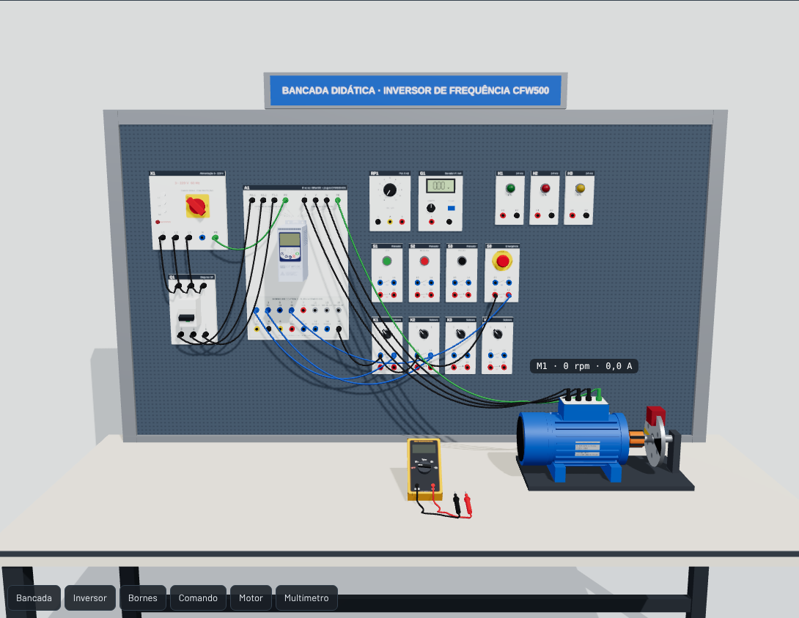

Passo a passo:

1. GND → S0 11 · S0 12 → DI4 (borne 7)
2. P0266 = 19 (Sem Falha Ext.)
3. Com o motor girando, aperte S0: F0091 e o motor para por inércia
4. Gire para soltar S0 e aperte a tecla O para o reset

| Parâmetro | Nome | Ajuste |
|---|---|---|
| P0266 | Função da Entrada DI4 | 19 (Sem Falha Ext.) |

**O que observar:** Com a DI4 em "Sem Falha Ext." a entrada precisa ficar ativa o tempo todo. Abriu (emergência apertada ou fio solto): **F0091**, os pulsos são cortados e o motor para por inércia. O relé DO1 de fábrica (Sem Falha) desliga junto.

### 13. Entrada analógica em 4-20 mA

Troque o potenciômetro pelo gerador de sinal em mA. Mude a chave S1.1 do plug-in para corrente (aba Bancada) e P0233 = 1. Com 12 mA a AI1 mostra 50 %. Solte um fio do laço e veja o alarme A0163.

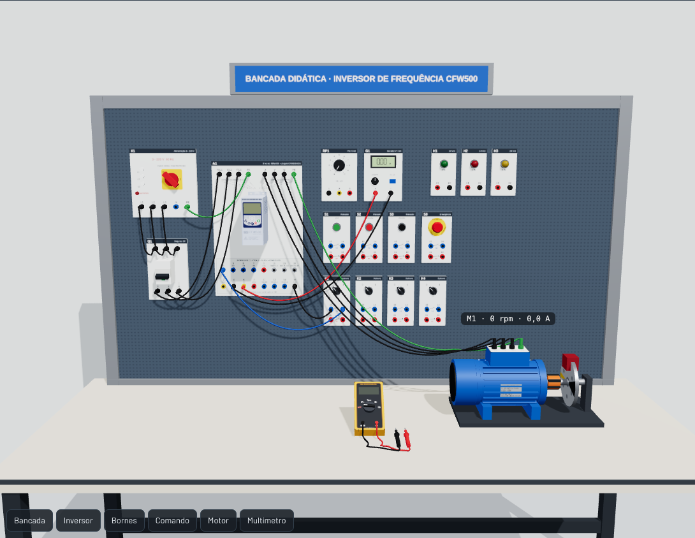

Passo a passo:

1. G1 + → AI1 (6) · G1 − → GND (4) · gerador em mA
2. Chave S1.1 do plug-in em mA (aba Bancada) · P0233 = 1 (4 a 20 mA)
3. Ajuste 12,0 mA: P0018 = 50,0 %
4. Remova um fio do laço: A0163 (sinal abaixo de 2 mA)

| Parâmetro | Nome | Ajuste |
|---|---|---|
| P0233 | Sinal da Entrada AI1 | 1 (4 a 20 mA) |
| P0222 | Sel. Referência REM | 1 (AI1) |

**O que observar:** Em corrente a AI1 passa a ter 500 Ω: 12 mA aparecem como 6,0 V no borne. Com P0233 = 1 a escala é 4 mA = 0 % e 20 mA = 100 %. Abaixo de 2 mA o inversor mostra o alarme **A0163** (laço aberto).

### 14. Inércia alta e a regulação do link DC

Acople o volante de inércia (aba Bancada) e ajuste a desaceleração para 1 s. Pare o motor a partir de 60 Hz: a tensão do link DC (P0004) sobe e o inversor estica a rampa sozinho para não cair em F0022.

Passo a passo:

1. Aba Bancada: acople o volante de inércia
2. P0101 = 1,0 s
3. Gire até 60 Hz e pare: acompanhe P0004 e o aviso "regulação do link DC"

| Parâmetro | Nome | Ajuste |
|---|---|---|
| P0101 | Tempo Desaceleração | 1,0 s |

**O que observar:** Medido na bancada: com o volante e P0101 = 1 s o motor leva cerca de **5,5 s** para parar e o link DC chega a **396 V**, sem falha. Se subir P0151 para 600 V (regulação fora de ação), a mesma parada dá **F0022**.

### Fios de cada montagem pronta

A aba Bancada e o botão "Montar os fios para mim" usam estas ligações:

- **Só a força (rede, disjuntor, inversor, motor):** X1 L1 → Q1 1; X1 L2 → Q1 3; X1 L3 → Q1 5; Q1 2 → A1 R/L1; Q1 4 → A1 S/L2; Q1 6 → A1 T/L3; X1 PE → A1 PE; A1 U → M1 U1; A1 V → M1 V1; A1 W → M1 W1; A1 PE → M1 PE.
- **Gira/Para (K1 em DI1) e sentido (K2 em DI2):** A1 16 GND → K1 13; K1 14 → A1 1 DI1; K1 13 → K2 13; K2 14 → A1 3 DI2 (mais os fios da força).
- **Gira/Para em DI1 + potenciômetro em AI1:** A1 8 +10V → RP1 3; A1 6 AI1 → RP1 2; A1 4 GND → RP1 1; A1 16 GND → K1 13; K1 14 → A1 1 DI1; K1 13 → K2 13; K2 14 → A1 3 DI2 (mais os fios da força).
- **Start (S1 NA em DI1) e Stop (S2 NF em DI2):** A1 16 GND → S1 13; S1 14 → A1 1 DI1; S1 13 → S2 21; S2 22 → A1 3 DI2 (mais os fios da força).
- **Multispeed: K1 em DI1, K2 em DI2, K3 em DI3 e K4 em DI4:** A1 16 GND → K1 13; K1 14 → A1 1 DI1; K1 13 → K2 13; K2 14 → A1 3 DI2; K2 13 → K3 13; K3 14 → A1 5 DI3; K3 13 → K4 13; K4 14 → A1 7 DI4 (mais os fios da força).
- **Potenciômetro + DO1 (relé) em H1 e DO2 (transistor) em H3:** A1 8 +10V → RP1 3; A1 6 AI1 → RP1 2; A1 4 GND → RP1 1; A1 16 GND → K1 13; K1 14 → A1 1 DI1; A1 9 +24V → A1 11 DO1-RL-C; A1 13 DO1-RL-NA → H1 X1; H1 X2 → A1 16 GND; A1 9 +24V → H3 X1; H3 X2 → A1 10 DO2-TR (mais os fios da força).
- **Gira/Para (K1), sentido (K2) e emergência S0 (NF) em DI4:** A1 16 GND → K1 13; K1 14 → A1 1 DI1; K1 13 → K2 13; K2 14 → A1 3 DI2; K2 13 → S0 11; S0 12 → A1 7 DI4 (mais os fios da força).
- **Gira/Para em DI1 + gerador 4-20 mA em AI1:** A1 16 GND → K1 13; K1 14 → A1 1 DI1; G1 + → A1 6 AI1; G1 − → A1 4 GND (mais os fios da força).

## 9. Números para conferir

Medidos no próprio simulador, com os parâmetros de fábrica e 30 % no freio de carga, salvo indicação.

| Situação | Resultado |
|---|---|
| Rede ligada, inversor parado | P0004 = 311 V; +24 V = 24,0 V; +10 V = 10,0 V |
| Tecla I em LOCAL | Parte e fica em 3,0 Hz (P0133) |
| 30 Hz | 875 rpm, 110 V, 1,9 A |
| 60 Hz | 1776 rpm, 220 V, 2,0 A |
| 60 Hz com 100 % no freio | 1725 rpm, 3,0 A, torque 99 %, 0,90 kW (a placa do motor) |
| Partida com 100 % no freio e P0136 = 3 % | O motor não parte: a corrente vai ao limite de 6,5 A (P0135). Com P0136 = 10 % ele parte e chega a 1725 rpm |
| Potenciômetro no meio | 4,92 V, P0018 = 49,2 %, 34,0 Hz |
| Gerador em 12 mA, S1.1 em mA, P0233 = 1 | P0018 = 50,0 % |
| Resistência entre U1 e V1 do motor | 6,8 Ω |
| Potenciômetro solto, bornes 1 e 3 | 5,00 kΩ (ligado ao inversor lê 4,94 kΩ: a AI1 fica em paralelo) |
| Motor com duas fases trocadas | Gira ao contrário |
| Motor com uma fase solta | Não parte e a corrente sobe ao limite |
| Motor direto na rede (sem inversor) | Partida direta: 1776 rpm |
| P0156 a P0158 = 2,0 A com carga nominal | F0072 (sobrecarga do motor) depois de alguns segundos |
| Volante de inércia, P0101 = 1 s, parada a partir de 60 Hz | A regulação do link DC estica a rampa para cerca de 5,5 s; Ud chega a 396 V |
| O mesmo com P0151 = 600 V | F0022 (sobretensão no link DC) |
| Volante de inércia e P0100 = 0,5 s | A limitação de corrente segura a rampa: 1,1 s até 60 Hz, pico de 6,4 A |

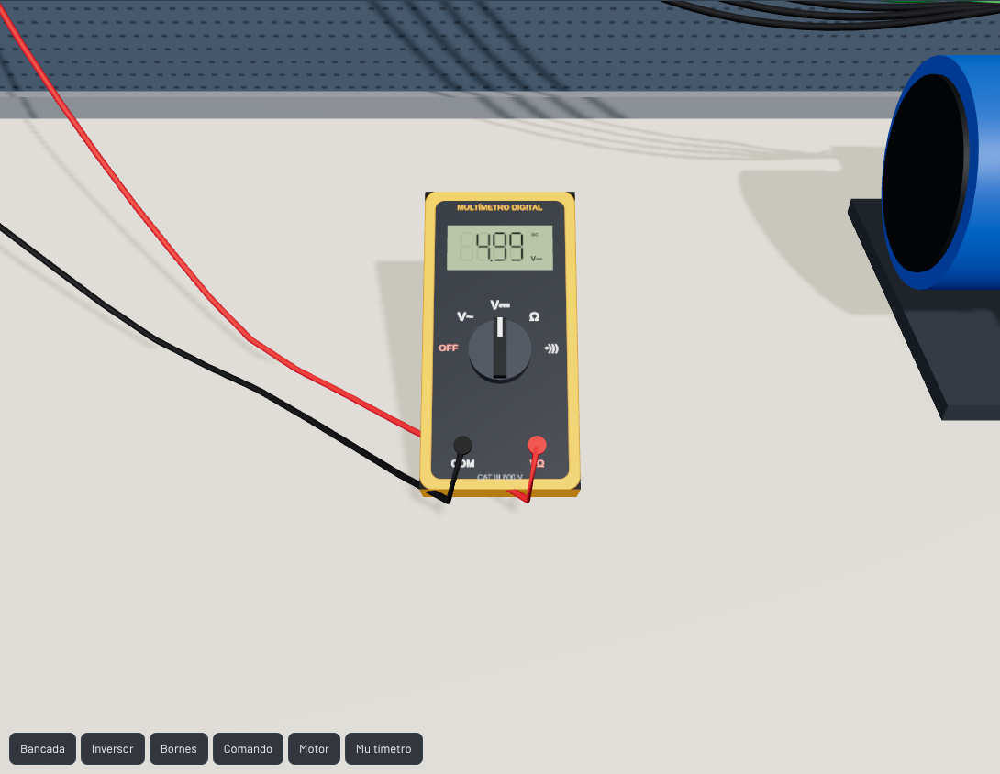

## 10. Falhas, alarmes e CONF que a bancada provoca

| Código | Nome | Como aparece na bancada |
|---|---|---|
| F0021 | Subtensão no Link DC | Tensão de alimentação baixa ou falta de fase na entrada (Ud < 200 Vcc em 200-240 Vca). |
| F0022 | Sobretensão no Link DC | Inércia de carga muito alta ou rampa de desaceleração muito rápida (Ud > 410 Vcc em 200-240 Vca). |
| F0033 | Falha no Autoajuste | Erro nas conexões do motor: verifique a caixa de ligações e os bornes U, V e W. |
| F0048 | Sobrecarga nos IGBTs | Corrente alta na saída do inversor. |
| F0051 | Sobretemperatura nos IGBTs | Temperatura ambiente alta e corrente de saída elevada, ventilador bloqueado. |
| F0070 | Sobrecorrente/Curto-circuito | Curto-circuito entre duas fases do motor, rampa de aceleração muito curta ou partida com o motor girando sem Flying Start. |
| F0072 | Sobrecarga no Motor | Ajuste de P0156, P0157 e P0158 baixo para o motor ou carga no eixo muito alta (60 s em 1,5 x P0401). |
| F0074 | Falta à Terra | Curto para o terra em uma ou mais fases de saída. |
| F0076 | Erro de Conexão no Motor | Motor com falta de fase, desconectado ou com correntes desequilibradas. |
| F0079 | Falha Sinais Encoder | Controle vetorial com sensor (P0202 = 4) sem módulo de encoder. |
| F0091 | Falha Externa | Fiação da DIx programada para "Sem Falha Ext." aberta ou com mau contato. |
| A0046 | Carga Alta no Motor | Ajuste de P0156, P0157 e P0158 baixo para o motor ou carga no eixo alta. |
| A0047 | Carga Alta nos IGBTs | Corrente alta na saída do inversor. |
| A0050 | Temperatura Elevada no Módulo de Potência | Temperatura ambiente alta e corrente de saída elevada. |
| A0090 | Alarme Externo | Fiação da DIx programada para "Sem Alarme Ext." aberta ou com mau contato. |
| A0163 | Falha Sinal AIx 4..20 mA | Sinal de corrente na entrada analógica interrompido ou abaixo de 2 mA. |

Reset de falha: tecla **O**, uma DI programada para Reset (20), desligar e ligar, ou auto-reset (P0340). F0076 vem desabilitada de fábrica (bit 4 de P0343), como no produto.

**CONF** aparece quando a programação é incoerente; o motor não parte e P0047 diz o motivo:

| P0047 | Motivo |
|---|---|
| 1 | Duas ou mais DIx programadas para Avanço (4) |
| 2 | Duas ou mais DIx programadas para Retorno (5) |
| 3 | Duas ou mais DIx programadas para Start (6) |
| 4 | Duas ou mais DIx programadas para Stop (7) |
| 5 | Duas ou mais DIx para Sentido de Giro (8), ou Sentido de Giro junto com Avanço/Retorno |
| 6 | Duas ou mais DIx programadas para LOC/REM (9) |
| 7 | Duas ou mais DIx programadas para Acelera E.P. (11) |
| 8 | Duas ou mais DIx programadas para Desacelera E.P. (12) |
| 9 | Duas ou mais DIx programadas para 2ª Rampa (14) |
| 12 | Duas ou mais DIx programadas para Bloqueia Programação (26) |
| 13 | Duas ou mais DIx programadas para Carrega Usuário 1 (27) |
| 14 | Duas ou mais DIx programadas para Carrega Usuário 2 (28) |
| 15 | DIx programada para Avanço (4) sem DIx para Retorno (5), ou o inverso |
| 16 | DIx programada para Start (6) sem DIx para Stop (7), ou o inverso |
| 17 | Referência programada para Multispeed (8) sem DIx para Multispeed (13), ou o inverso |
| 18 | Referência programada para E.P. (7) sem DIx para Acelera E.P. (11), ou o inverso |
| 19 | Gira/Para programado para DIx (1) sem DIx para Gira/Para, Habilita Geral, Parada Rápida, Avanço ou Start |
| 20 | DI2 (P0264) programada para PTC (29) |
| 21 | P0203 em PID via AI1 e referência programada para AI1 |
| 25 | Referência programada para AI2 ou AI3 e o módulo plug-in não tem AI2 e AI3 |
| 27 | Má configuração da curva V/f (P0142 a P0147) |
| 28 | Autoajuste em andamento (P0408) |
| 30 | Start-Up Orientado está ativo |
| 31 | Controle vetorial ativo com P0409 a P0413 em zero |
| 32 | Duas ou mais DIx para o mesmo bit de Multispeed: MS2 (DI1, DI2), MS1 (DI3) ou MS0 (DI4) |
| 33 | Rampa S (P0104) com referência por entrada analógica |
| 37 | Controle VVW PM e VVW HSRM não disponível na mecânica A IP20 |
| 40 | Duas ou mais DIx programadas para JOG (10) |

## 11. Erros de ligação que a bancada acusa

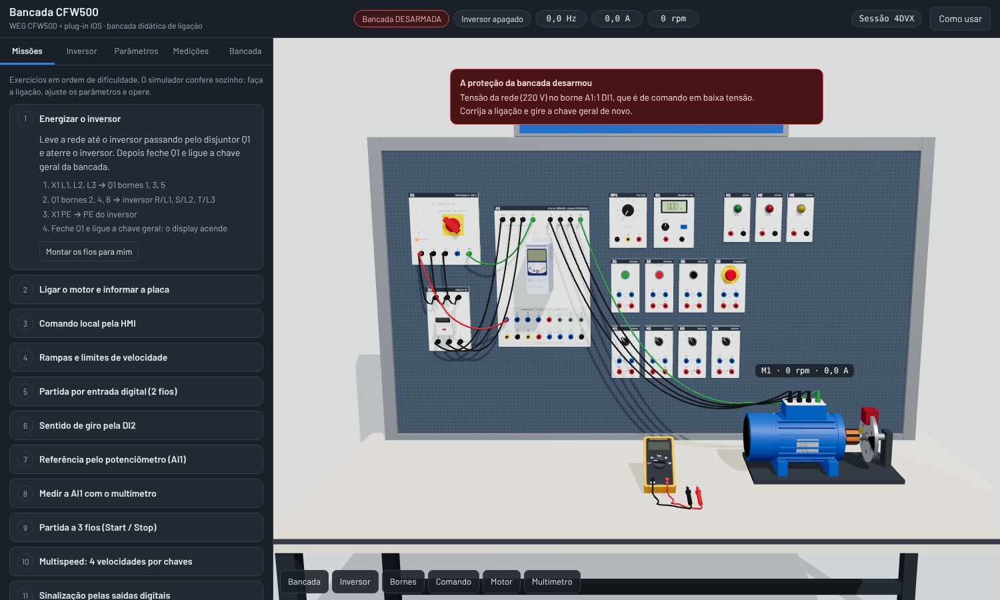

| Erro | O que acontece |
|---|---|
| Curto entre fases, ou fase com neutro ou terra | A proteção geral desarma e a tela diz entre quais bornes |
| 220 V em borne de comando, potenciômetro, sinaleiro ou gerador | Desarma e aponta o borne |
| Rede ligada em U, V ou W | Desarma, avisa e o inversor registra F0070 |
| Curto entre duas saídas (U com V, por exemplo) | F0070 ao dar a partida |
| Saída ligada ao PE | F0074 ao dar a partida |
| Curto no +24 V ou no +10 V | A fonte limita a corrente, a tensão cai e aparece um aviso |
| Multímetro em Ω ou continuidade com tensão no circuito | O visor mostra Err e a aba Medições explica |

Depois de corrigir, gire a chave geral de novo para rearmar.

## 12. O que é simulado e o que não é

A lista tem os **504 parâmetros** da referência rápida do manual V3.9X, todos navegáveis e graváveis pela HMI. **167** têm efeito na bancada; os demais aparecem com a etiqueta "guardado".

| Simulado | Só guarda o valor |
|---|---|
| Comando e referência por HMI, DIs, AI1, multispeed e E.P.; LOCAL/REMOTO; JOG; 2ª rampa; parada por rampa, inércia e parada rápida | Redes (serial, CAN, Profibus, Ethernet, BACnet, Bluetooth) |
| Rampas, rampa S, limites, frequência evitada, modo dormir | SoftPLC e aplicativo residente (PID interno e externo, bomba seca...) |
| Curva V/f com boost e compensações; VVW com autoajuste (P0408) | PID (P0203, P0520...) e Fire Mode |
| Limitação de corrente, regulação do link DC, frenagem CC, Flying Start | Ganhos do controle vetorial, encoder, VVW PM e HSRM |
| DO1, DO2, AO1 com as funções de fábrica e as de comparação (Fx, Ix, Tx) | AI2, AI3, entrada e saída em frequência, DI5 a DI8, DO3 a DO5 (não existem no plug-in IOS) |
| F0021, F0022, F0033, F0048, F0070, F0072, F0074, F0076, F0079, F0091; A0046, A0047, A0090, A0163; histórico de falhas; auto-reset | Relógio, HMI remota, função Copy |

Pontos em que o comportamento é dedução, e não leitura direta do manual:

- **DI 37 e 38** (Liga / Ac. E.P. e De. E.P. / Desl.): 37 liga no pulso e acelera enquanto apertada; 38, com contato NF, desacelera enquanto aberta e desliga ao chegar na mínima.
- **Zona morta da AI (P0230):** inativa, a referência vai de P0133 a P0134; ativa, vale AI × P0134 e nunca abaixo de P0133.
- **Saída analógica em corrente (P0253 = 1, 2, 4, 5):** aparece como a tensão equivalente sobre 500 Ω.
- **Modelo do motor:** conjugado, corrente e escorregamento seguem a placa; não é um modelo de fabricante.
- **Tempos internos:** inicialização de 1,4 s, autoajuste de 4 s.

## 13. Usar fora do HUB

1. Copie a pasta do simulador para o PC.
2. Clique duas vezes em **INSTALAR.bat** (instala o Node.js se faltar e cria o atalho).
3. Clique duas vezes em **INICIAR_SIMULADOR.bat**: o navegador abre em `http://localhost:3350`. Os alunos da mesma rede abrem `http://IP-DO-PC:3350` (o instalador oferece liberar a porta no firewall) e cada um recebe a sua sessão.
4. **TESTAR.bat** roda as verificações automáticas; a última linha deve dizer "0 falha(s)".

A simulação inteira roda no navegador. O comando `node tools/build-demo.js` gera `dist/bancada-cfw500.html`, um arquivo único que abre com dois cliques; ele precisa de internet só para baixar o three.js.

## 14. Problemas comuns

| Sintoma | Causa provável | Solução |
|---|---|---|
| O display não acende | Q1 aberto, chave geral desligada ou falta fio entre a rede e R/S/T | Confira os seis fios da força e meça 220 V entre R e S |
| Display com SUB | Só 127 V na entrada (uma fase e o neutro) | Ligue duas ou três fases |
| A chave fecha e o motor não gira | Inversor em LOCAL | Tecla LOC/REM até aparecer REM |
| Em REM o motor gira só a 3 Hz | P0222 = 1 (AI1) sem potenciômetro ligado | Ligue o potenciômetro ou use P0222 = 0 |
| A DI não ativa | Chave ligada ao +24 V com as DIs em NPN | Ligue ao GND (borne 4 ou 16) ou mude P0271 |
| Display com CONF | Programação incoerente das DIs ou da referência | Veja P0047 na aba Inversor |
| Parâmetro não aceita o valor | É cfg e o motor está girando, ou a senha está ativa | Pare o motor; ponha a senha em P0000 |
| Motor gira ao contrário | Duas fases trocadas entre U V W e U1 V1 W1 | Destroque dois fios |
| O sinaleiro não acende no relé | Faltou levar o +24 V ao comum do relé (borne 11) | Ligue 9 em 11 e use o 13 (NA) |
| A bancada desarma ao ligar | Curto ou 220 V onde não pode | Leia a mensagem vermelha, corrija e gire a chave geral |
| O multímetro mostra Err | Medindo Ω com o circuito energizado | Desligue a chave geral |
| Quero começar do zero |  | Aba Bancada: "Repor componentes e fios" ou "Apagar tudo" (só desta sessão); no inversor, P0204 = 5 |
| A bancada abriu em branco | A sua sessão está aberta em outra aba, ou esta é uma aba nova com todas em uso | Clique em "Sessão", no topo, e escolha a sua em "Abrir aqui" |
| Apareceu a montagem de outra pessoa | Aba nova continuou a última bancada livre deste navegador | Clique em "Sessão" e em "Nova sessão em branco nesta aba" |
