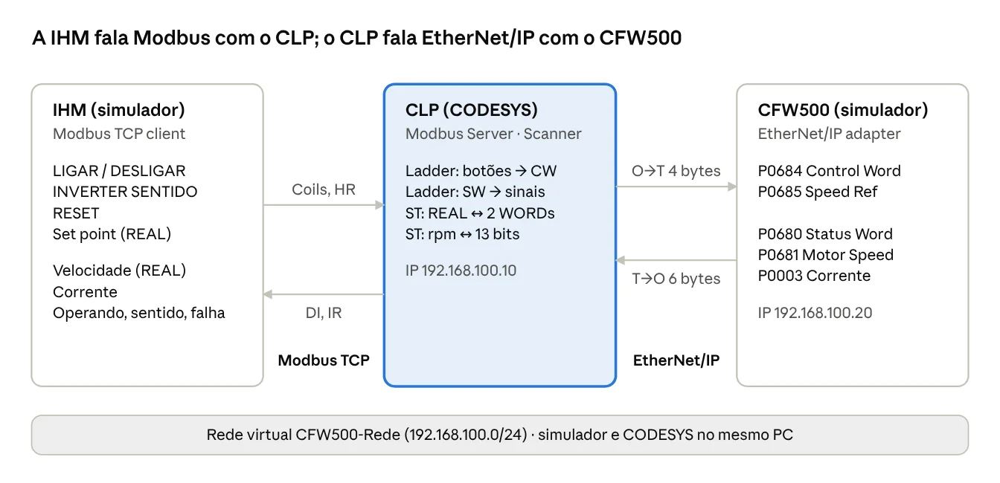
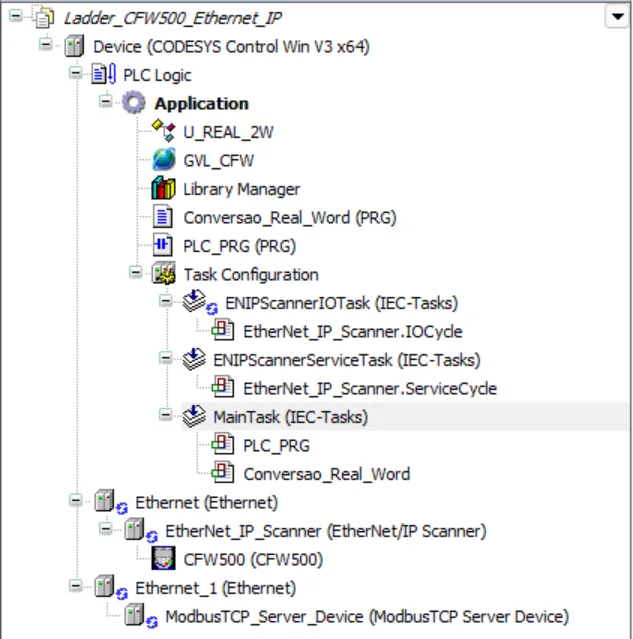
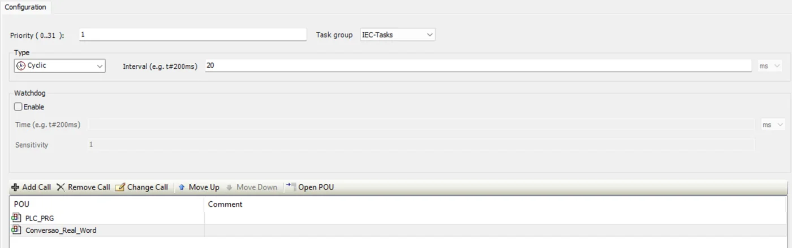
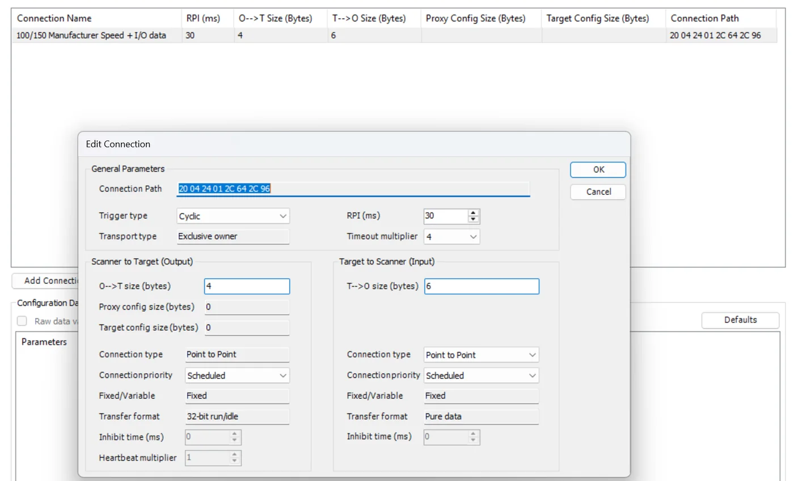
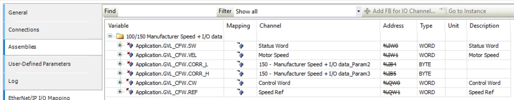
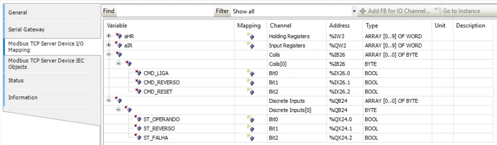
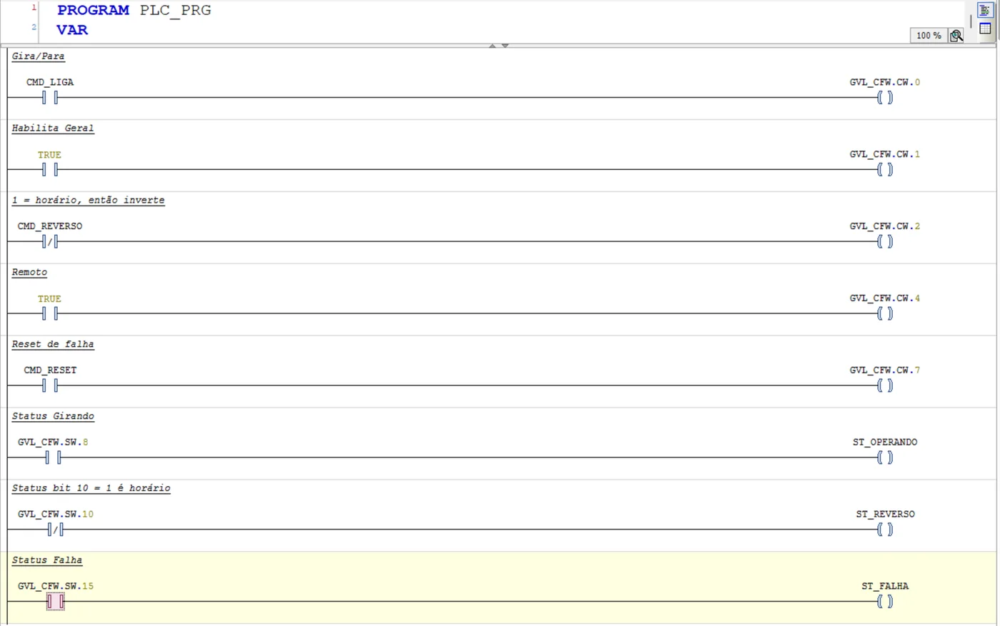
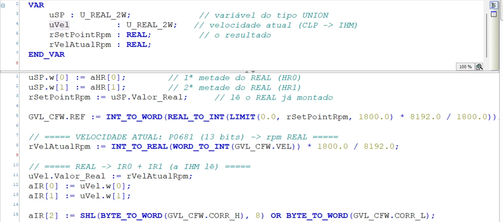

# CFW500: IHM Modbus + CODESYS + EtherNet/IP

Tutorial completo · Samuel Felipe Moreira

A IHM do simulador conversa com o CLP por **Modbus TCP**; o CLP conversa com o CFW500 por **EtherNet/IP**. Ao final, a IHM liga, desliga, inverte e reseta o inversor, envia o set point em REAL e mostra velocidade (REAL), corrente e estados. Os prints são do projeto funcionando.

## Arquitetura

A IHM nunca fala direto com o inversor. Tudo passa pelo CLP, que traduz Modbus em EtherNet/IP e vice-versa.



No print, a rede aparece como *CFW500-Rede*, o nome antigo. No HUB, a placa de rede virtual se chama **SIM-HUB**, com os mesmos endereços.

## Mapa de dados

Cada sinal da IHM, onde ele mora no Modbus, a variável no CLP e o parâmetro do inversor. Cada área Modbus conta a partir de 0, separadamente.

| Sinal | IHM (tag) | Modbus | Variável no CLP | CFW500 |
| --- | --- | --- | --- | --- |
| Ligar/desligar | CMD_LIGA | Coil 0 | CMD_LIGA (%IX26.0) | P0684 bit 0 |
| Inverter sentido | CMD_REVERSO | Coil 1 | CMD_REVERSO (%IX26.1) | P0684 bit 2 (invertido) |
| Reset de falha | CMD_RESET | Coil 2 (pulso 500 ms) | CMD_RESET (%IX26.2) | P0684 bit 7 |
| Set point (rpm) | SP_VELOCIDADE | HR 0 + HR 1 (REAL) | aHR[0], aHR[1] | P0685 (13 bits) |
| Motor operando | ST_OPERANDO | Discrete Input 0 | ST_OPERANDO (%QX24.0) | P0680 bit 8 |
| Sentido anti-horário | ST_REVERSO | Discrete Input 1 | ST_REVERSO (%QX24.1) | NOT P0680 bit 10 |
| Inversor em falha | ST_FALHA | Discrete Input 2 | ST_FALHA (%QX24.2) | P0680 bit 15 |
| Velocidade atual (rpm) | VEL_ATUAL | IR 0 + IR 1 (REAL) | aIR[0], aIR[1] | P0681 (13 bits) |
| Corrente (×0,1 A) | CORRENTE | IR 2 | aIR[2] | P0003 (3ª palavra de entrada) |

Os endereços %IX/%QX são os do projeto dos prints; no seu podem ser outros.

## Parte 1: No HUB e no simulador

### 1.1 Rede e IP

- No HUB, a aba **Rede virtual** deve mostrar **Rede pronta**. Ela cria 192.168.100.10 para o CODESYS e 192.168.100.20 para o CFW500.
- Em **Dispositivos**, escolha o **Inversor WEG CFW500** e clique em **Iniciar** antes de iniciar o CODESYS Control Win.
- No simulador, aba **Rede EtherNet/IP**, quadro **Endereço IP do inversor**: deve dizer "Respondendo em 192.168.100.20".

Fora do HUB, os mesmos passos são feitos pelos arquivos **2-criar-rede-virtual.bat** e **3-iniciar-simulador.bat**, na pasta do simulador.

### 1.2 Inversor obedecendo à rede

- Motor parado. Aba **CLP virtual** → **Parametrizar inversor para comando via rede** → **Aplicar**. Grava P0220 = 1, P0222 = 11, P0226 = 9, P0227 = 4, P0228 = 5, P0105 = 5, P0313 = 1.
- Aba **Parâmetros**: **P0820 = 3** (3ª palavra de entrada = corrente P0003) e depois **P0849 = 1** (aplica).
- O display do inversor mostra **REM**, e o quadro "Configure no seu CLP" mostra **Input 3 palavras (6 bytes)** e **Output 2 palavras (4 bytes)**.

### 1.3 Tags da IHM (aba IHM Modbus)

| Elemento | Área | End. | Tipo | Fator | Dec. | Botão |
| --- | --- | --- | --- | --- | --- | --- |
| Set point | Holding Register | 0 | REAL | 1 | 1 | — |
| Liga/Desliga | Coil | 0 | BOOL | — | — | Alternar |
| Inverter sentido | Coil | 1 | BOOL | — | — | Alternar |
| Reset de falha | Coil | 2 | BOOL | — | — | Pulso 500 ms |
| Velocidade atual | Input Register | 0 | REAL | 1 | 1 | — |
| Corrente | Input Register | **2** | UINT | 0,1 | 1 | — |
| Motor operando | Discrete Input | 0 | BOOL | — | — | — |
| Sentido anti-horário | Discrete Input | 1 | BOOL | — | — | — |
| Inversor em falha | Discrete Input | 2 | BOOL | — | — | — |

Em cima: **IP do CLP = 192.168.100.10**, porta 502, Unit ID 1, **Ordem 32 bits = Palavra baixa primeiro (CODESYS)** → **Salvar configuração**. A comunicação só é ativada no teste (Parte 8).

Um REAL ocupa dois registradores: a velocidade usa IR0 **e** IR1, por isso a corrente vai no IR2.

## Parte 2: No CODESYS, o projeto

O projeto tem **duas interfaces Ethernet**: uma para o Scanner EtherNet/IP (com o CFW500 embaixo) e outra para o Modbus TCP Server.



Montagem da árvore:

- **File → New Project → Standard project**, device **CODESYS Control Win V3 x64**.
- Botão direito em **Device** → **Add Device** → **Ethernet**. Na aba General, interface **SIM-HUB (192.168.100.10)** e **desmarque** "Adjust operating system settings".
- Botão direito nessa **Ethernet** → Add Device → **EtherNet/IP Scanner**.
- Botão direito em **Device** → Add Device → outra **Ethernet** (fica Ethernet_1) → embaixo dela, **ModbusTCP Server Device**.
- Em **Application**: a DUT **U_REAL_2W**, a lista **GVL_CFW** e os programas **PLC_PRG** (Ladder) e **Conversao_Real_Word** (ST). Eles são criados nas Partes 5 a 7.

### A tarefa

Os dois programas precisam estar na **MainTask**: senão compilam, mas nunca rodam. Dois cliques em **MainTask** → **Add Call** → escolha cada programa.



No projeto dos prints: **Cyclic, 20 ms**, prioridade 1.

## Parte 3: EtherNet/IP com o CFW500

### 3.1 Adicionar o inversor

- Baixe o EDS no HUB: **Dispositivos** → **Inversor WEG CFW500** → **Arquivos para o CLP** → `eip_cfw500_ceth2_v11x.eds`.
- **Tools → Device Repository → Install** → escolha o EDS baixado.
- Botão direito em **EtherNet_IP_Scanner** → Add Device → **CFW500**.
- Dois cliques no **CFW500** → General → **IP Address = 192.168.100.20**.

### 3.2 Conexão e tamanhos

Aba **Connections** → dois cliques na conexão **100/150 Manufacturer Speed + I/O data**:



| Campo | Valor | Por quê |
| --- | --- | --- |
| O→T size (saída) | **4 bytes** | Control Word + Speed Ref |
| T→O size (entrada) | **6 bytes** | Status Word + Motor Speed + corrente (P0820 = 3) |
| RPI | 10 a 30 ms | 30 ms no print |
| Connection type T→O | Point to Point | evita problema com tudo no mesmo PC |

O tamanho tem de bater com o inversor. Diferente disso, o Forward Open é recusado e a conexão não abre.

Lembrete: **T→O** = do inversor (**T**arget) para o CLP (**O**riginator) = **entrada**.

### 3.3 I/O Mapping

Aba **EtherNet/IP I/O Mapping** → ligue cada canal a uma variável da GVL_CFW (Parte 5) com o botão **…** da coluna Variable:



| Canal | Variável | Parâmetro |
| --- | --- | --- |
| Status Word | GVL_CFW.SW | P0680 |
| Motor Speed | GVL_CFW.VEL | P0681 |
| 150 – …_Param2 (%IB4) | GVL_CFW.CORR_L | P0003, byte baixo |
| 150 – …_Param3 (%IB5) | GVL_CFW.CORR_H | P0003, byte alto |
| Control Word | GVL_CFW.CW | P0684 |
| Speed Ref | GVL_CFW.REF | P0685 |

A corrente aparece **picada em dois BYTEs** porque o EDS genérico não sabe o nome da 3ª palavra. O programa junta os dois na Parte 7.

## Parte 4: Modbus TCP Server

### 4.1 Configuração (aba General)

- Dois cliques no **ModbusTCP_Server_Device** → **General**: porta **502**, Unit ID **1**.
- **Holding Registers = 10** e **Input Registers = 10** (sobra espaço para tags futuras).
- Ative as **áreas de bit** (Coils e Discrete Inputs). Sem isso, os botões da IHM recebem exceção.

### 4.2 I/O Mapping

Aba **Modbus TCP Server Device I/O Mapping**:



- **Holding Registers**: dois cliques na coluna Variable, digite `aHR` e Enter. O CODESYS cria o vetor `ARRAY[0..9] OF WORD` sozinho.
- **Input Registers**: o mesmo com `aIR`.
- **Coils**: clique no **+** até aparecerem os bits e dê nome a cada um: Bit0 = CMD_LIGA, Bit1 = CMD_REVERSO, Bit2 = CMD_RESET.
- **Discrete Inputs**: Bit0 = ST_OPERANDO, Bit1 = ST_REVERSO, Bit2 = ST_FALHA.
- **Always update variables = Enabled 1**.

| Área Modbus | No CLP é | Quem escreve |
| --- | --- | --- |
| Coils, Holding Registers | entrada (%IX, %IW) | a IHM |
| Discrete Inputs, Input Registers | saída (%QX, %QW) | o CLP |

Variáveis criadas digitando o nome aqui **não** são declaradas no programa. Declarar de novo dá erro de "declarada duas vezes".

## Parte 5: O tipo UNION e a GVL_CFW

### 5.1 UNION: o REAL e as duas palavras na mesma memória

Um REAL tem 32 bits e o Modbus só transporta palavras de 16. A UNION faz o REAL e um vetor de 2 WORDs ocuparem **os mesmos 4 bytes**: escreveu nas palavras, o REAL aparece montado (e vice-versa). É um **tipo** (um molde), não uma variável.

Botão direito em **Application** → Add Object → **DUT** → nome `U_REAL_2W`, tipo **Union**:

```
TYPE U_REAL_2W :
UNION
    Valor_Real : REAL;                  // o número real
    w          : ARRAY[0..1] OF WORD;   // w[0] = palavra baixa, w[1] = palavra alta
END_UNION
END_TYPE
```

### 5.2 GVL_CFW: as palavras do inversor

Botão direito em **Application** → Add Object → **Global Variable List** → `GVL_CFW`:

```
VAR_GLOBAL
    CW     : WORD;   // Control Word  -> P0684 (saída)
    REF    : WORD;   // Speed Ref     -> P0685 (saída)
    SW     : WORD;   // Status Word   <- P0680 (entrada)
    VEL    : WORD;   // Motor Speed   <- P0681 (entrada)
    CORR_L : BYTE;   // corrente P0003, byte baixo (entrada)
    CORR_H : BYTE;   // corrente P0003, byte alto  (entrada)
END_VAR
```

Depois de criar, faça o I/O Mapping da Parte 3.3.

## Parte 6: Programa Ladder (PLC_PRG), botões e sinais

O Ladder faz a parte digital: os botões da IHM viram bits da Control Word, e os bits da Status Word viram as lâmpadas da IHM.



| Linha | Contato | Bobina | Função |
| --- | --- | --- | --- |
| 1 | CMD_LIGA (NA) | GVL_CFW.CW.0 | Gira/Para |
| 2 | TRUE | GVL_CFW.CW.1 | Habilita Geral (sempre) |
| 3 | CMD_REVERSO (**NF**) | GVL_CFW.CW.2 | bit 2 = 1 é horário, por isso o contato é fechado |
| 4 | TRUE | GVL_CFW.CW.4 | Remoto (sempre) |
| 5 | CMD_RESET (NA) | GVL_CFW.CW.7 | Reset de falha |
| 6 | GVL_CFW.SW.8 (NA) | ST_OPERANDO | motor girando |
| 7 | GVL_CFW.SW.10 (**NF**) | ST_REVERSO | bit 10 = 1 é horário, então NF = anti-horário |
| 8 | GVL_CFW.SW.15 (NA) | ST_FALHA | inversor em falha |

Sem a linha 2 (Habilita Geral) o motor não gira, mesmo com o botão LIGAR acionado.

## Parte 7: Programa ST (Conversao_Real_Word), velocidade e corrente

O ST faz a parte numérica: monta o REAL do set point, converte para 13 bits e faz o caminho de volta para a IHM.



Código completo:

```
PROGRAM Conversao_Real_Word
VAR
    uSP          : U_REAL_2W;   // set point (IHM -> CLP)
    uVel         : U_REAL_2W;   // velocidade atual (CLP -> IHM)
    rSetPointRpm : REAL;
    rVelAtualRpm : REAL;
END_VAR

// 1) set point da IHM: HR0 + HR1 -> REAL
uSP.w[0] := aHR[0];
uSP.w[1] := aHR[1];
rSetPointRpm := uSP.Valor_Real;

// 2) set point para o CFW500: rpm -> 13 bits (8192 = P0403 = 60 Hz = 1800 rpm)
GVL_CFW.REF := INT_TO_WORD(REAL_TO_INT(LIMIT(0.0, rSetPointRpm, 1800.0) * 8192.0 / 1800.0));

// 3) velocidade real: P0681 (13 bits, com sinal) -> rpm REAL
rVelAtualRpm := INT_TO_REAL(WORD_TO_INT(GVL_CFW.VEL)) * 1800.0 / 8192.0;

// 4) REAL -> IR0 + IR1 (a IHM lê)
uVel.Valor_Real := rVelAtualRpm;
aIR[0] := uVel.w[0];
aIR[1] := uVel.w[1];

// 5) corrente: 2 bytes -> WORD -> IR2 (26 = 2,6 A; a IHM aplica o fator 0,1)
aIR[2] := SHL(BYTE_TO_WORD(GVL_CFW.CORR_H), 8) OR BYTE_TO_WORD(GVL_CFW.CORR_L);
```

| Trecho | O que faz |
| --- | --- |
| `uSP.w[...] := aHR[...]` | coloca as duas palavras na UNION; Valor_Real já sai montado |
| `* 8192.0 / 1800.0` | regra de três: 8192 vale 100% da P0403 (60 Hz = 1800 rpm síncronos) |
| `LIMIT(0.0, …, 1800.0)` | não deixa a IHM pedir fora da faixa |
| `WORD_TO_INT(VEL)` | no anti-horário a P0681 vem negativa; sem isso, –4096 viraria 61440 |
| `SHL(…, 8) OR …` | o byte alto sobe 8 bits e o baixo encaixa embaixo |

Os cálculos são feitos em REAL de propósito: em INT, 900 × 8192 estoura o limite de 32767.

## Parte 8: Testar e diagnosticar

### 8.1 Roteiro de teste

- **Build** (F11): 0 erros.
- **Online → Login** (Alt+F8) → aceite o download → **Start** (F5).
- No simulador: o chip **P0801** fica verde (**Data Active**) e os LEDs MS/NS do módulo ficam verdes fixos.
- Aba **IHM Modbus** → **Ativar comunicação**. A IHM mostra "MODBUS TCP" em verde.
- Abra a IHM (botão **IHM em janela**) e faça:

| Ação na IHM | Resultado esperado |
| --- | --- |
| Set point **900** | rSetPointRpm = 900.0 no CODESYS; P0685 = 4096 na aba Rede |
| **LIGAR** | motor acelera; lâmpada "MOTOR EM OPERAÇÃO" acende; mostrador sobe até ~900 rpm |
| **INVERTER SENTIDO** | motor desacelera, inverte; IHM mostra "ANTI-HORÁRIO" e velocidade negativa |
| Massa 60 kg + caixas | chip **CORRENTE** sobe |
| "Travar esteira" no simulador | após alguns segundos, F0072; faixa vermelha **FALHA** |
| Destravar + **RESET** | falha some; se LIGAR estiver ativo, o motor volta a girar |

### 8.2 Problemas comuns

| Sintoma | Causa provável | Solução |
| --- | --- | --- |
| P0801 em Wait Comm | Forward Open recusado ou IP errado | confira IP 192.168.100.20 e os tamanhos 4 / 6 bytes |
| Conexão caiu após P0849 = 1 | T→O não é 6 bytes no CODESYS | ajuste a conexão (Parte 3.2) |
| IHM "SEM COMUNICAÇÃO" | Server Modbus parado ou IP do CLP errado na IHM | CLP em RUN; IP 192.168.100.10, porta 502 |
| Botão da IHM dá exceção | áreas de bit desativadas no Server | ative Coils e Discrete Inputs (Parte 4.1) |
| Set point ou velocidade com número absurdo (ex.: 4.3E-35) | palavras do REAL trocadas | troque w[0] e w[1] no programa, ou a "Ordem 32 bits" na IHM |
| Corrente errada | corrente no IR1 (em cima do REAL) | corrente no **IR2** |
| Tudo certo, mas nada muda | programa fora da MainTask | Add Call na MainTask (Parte 2) |
| Motor não gira com LIGAR | inversor em LOC ou CW.1 = 0 | display em REM; linha 2 do Ladder |
| A0149 no inversor | CLP em STOP ou conexão perdida | Start no CODESYS |
| Interface SIM-HUB não aparece no CODESYS | rede virtual não criada | aba **Rede virtual** do HUB → criar a rede |

## Extra 1: Rampas de aceleração e desaceleração pelo CLP

O CFW500 deixa acrescentar palavras de **saída** na conexão EtherNet/IP. Cada palavra extra escreve um parâmetro a cada RPI. Aqui, a 3ª e a 4ª palavras escrevem as rampas.

| Parâmetro | Função | Unidade na rede | Exemplo |
| --- | --- | --- | --- |
| P0100 | Tempo de aceleração (0 até P0134) | décimos de segundo | 50 = 5,0 s |
| P0101 | Tempo de desaceleração | décimos de segundo | 30 = 3,0 s |

### E1.1 No inversor (aba Parâmetros, motor parado)

- **P0835 = 100**: a 3ª palavra de saída escreve a P0100.
- **P0836 = 101**: a 4ª palavra de saída escreve a P0101.
- **P0849 = 1**: aplica. O quadro "Configure no seu CLP" passa a mostrar **Output 4 palavras (8 bytes)**.

### E1.2 No CODESYS

- Conexão do CFW500 (Parte 3.2): **O→T size = 8 bytes**. O T→O continua com 6.
- No I/O Mapping aparecem quatro BYTEs de saída novos (100 – …_Param2 a _Param5). Como na corrente, cada palavra vem picada em dois bytes: baixo primeiro, alto depois.
- Acrescente na GVL_CFW e ligue no I/O Mapping, na ordem:

```
    ACEL_L  : BYTE;   // P0100, byte baixo  (100 - ..._Param2)
    ACEL_H  : BYTE;   // P0100, byte alto   (100 - ..._Param3)
    DESAC_L : BYTE;   // P0101, byte baixo  (100 - ..._Param4)
    DESAC_H : BYTE;   // P0101, byte alto   (100 - ..._Param5)
```

- No Conversao_Real_Word, acrescente no VAR e no fim do código:

```
VAR
    rRampaAcel_s  : REAL := 5.0;   // segundos (altere no online)
    rRampaDesac_s : REAL := 3.0;
    wAcel, wDesac : WORD;
END_VAR

// 6) rampas: segundos -> décimos -> 2 bytes cada
wAcel  := REAL_TO_WORD(LIMIT(0.1, rRampaAcel_s,  999.0) * 10.0);
wDesac := REAL_TO_WORD(LIMIT(0.1, rRampaDesac_s, 999.0) * 10.0);
GVL_CFW.ACEL_L  := WORD_TO_BYTE(wAcel);              // byte baixo
GVL_CFW.ACEL_H  := WORD_TO_BYTE(SHR(wAcel, 8));      // byte alto
GVL_CFW.DESAC_L := WORD_TO_BYTE(wDesac);
GVL_CFW.DESAC_H := WORD_TO_BYTE(SHR(wDesac, 8));
```

`SHR(…, 8)` é o contrário do SHL da corrente: desce o byte alto para poder separá-lo.

### E1.3 Testar

No online, mude `rRampaAcel_s` para 2.0 (Ctrl+F7) e ligue o motor: ele acelera bem mais rápido. Na aba Parâmetros do simulador, P0100 mostra **2,0 s**.

Cuidados:

- O `LIMIT(0.1, …)` existe porque 0 está fora da faixa da P0100 e o inversor recusa.
- Enquanto a conexão estiver aberta, o CLP manda o valor a cada RPI: o que for digitado na HMI do inversor é sobrescrito.
- Com O→T = 8 bytes e P0835/P0836 = 0, o Forward Open é recusado: os dois lados têm de bater.
- Este extra não foi testado num CODESYS real; os nomes dos canais podem variar.

## Extra 2: Swap de palavras e bytes do REAL

O simulador e o CODESYS usam a mesma ordem, então o programa da Parte 7 funciona direto. Outros equipamentos (outras IHMs, medidores, CLPs) podem mandar os 4 bytes do REAL em outra ordem. Os bytes são chamados **A B C D**, do mais para o menos significativo. Exemplo: 1500,5 = 16#44BB9000 (A = 44, B = BB, C = 90, D = 00).

| Nome | 1º registrador | 2º registrador | O que fazer no CODESYS |
| --- | --- | --- | --- |
| CDAB (palavra baixa primeiro) | 16#9000 | 16#44BB | nada: é a ordem nativa do CODESYS |
| ABCD (palavra alta primeiro) | 16#44BB | 16#9000 | trocar as palavras |
| DCBA | 16#0090 | 16#BB44 | trocar os bytes |
| BADC | 16#BB44 | 16#0090 | trocar bytes **e** palavras |

### E2.1 Função: registradores → REAL

Add Object → **POU** → tipo **Function**, retorno **REAL**. `ROL(w, 8)` gira 8 bits e troca os dois bytes de uma WORD.

```
FUNCTION FC_WORDS_TO_REAL : REAL
VAR_INPUT
    wReg0     : WORD;   // 1º registrador (endereço menor)
    wReg1     : WORD;   // 2º registrador
    xSwapWord : BOOL;   // TRUE em ABCD e BADC
    xSwapByte : BOOL;   // TRUE em DCBA e BADC
END_VAR
VAR
    u      : U_REAL_2W;
    w0, w1 : WORD;
END_VAR

w0 := wReg0;
w1 := wReg1;
IF xSwapByte THEN
    w0 := ROL(w0, 8);
    w1 := ROL(w1, 8);
END_IF
IF xSwapWord THEN
    u.w[0] := w1;  u.w[1] := w0;
ELSE
    u.w[0] := w0;  u.w[1] := w1;
END_IF
FC_WORDS_TO_REAL := u.Valor_Real;
```

### E2.2 Bloco: REAL → registradores

Add Object → **POU** → tipo **Function Block** (devolve duas saídas).

```
FUNCTION_BLOCK FB_REAL_TO_WORDS
VAR_INPUT
    rValor    : REAL;
    xSwapWord : BOOL;
    xSwapByte : BOOL;
END_VAR
VAR_OUTPUT
    wReg0 : WORD;   // vai para o 1º registrador
    wReg1 : WORD;   // vai para o 2º registrador
END_VAR
VAR
    u : U_REAL_2W;
END_VAR

u.Valor_Real := rValor;
IF xSwapWord THEN
    wReg0 := u.w[1];  wReg1 := u.w[0];
ELSE
    wReg0 := u.w[0];  wReg1 := u.w[1];
END_IF
IF xSwapByte THEN
    wReg0 := ROL(wReg0, 8);
    wReg1 := ROL(wReg1, 8);
END_IF
```

### E2.3 Usando no lugar dos blocos 1 e 4 da Parte 7

```
VAR
    fbVel  : FB_REAL_TO_WORDS;
    xSwapW : BOOL := FALSE;   // ajuste conforme a tabela
    xSwapB : BOOL := FALSE;
END_VAR

rSetPointRpm := FC_WORDS_TO_REAL(aHR[0], aHR[1], xSwapW, xSwapB);

fbVel(rValor := rVelAtualRpm, xSwapWord := xSwapW, xSwapByte := xSwapB);
aIR[0] := fbVel.wReg0;
aIR[1] := fbVel.wReg1;
```

`VAR_INPUT` é por onde a função recebe os valores de quem chama; `VAR` é rascunho interno que ninguém de fora enxerga.

### E2.4 Descobrir a ordem de um equipamento

- Mande **1500,5** do equipamento.
- No CODESYS online, veja os dois registradores em hexa e compare com a tabela.
- Ajuste `xSwapW` e `xSwapB` no online até `rSetPointRpm` mostrar 1500.5. São só quatro combinações.

Para treinar com o simulador: na aba IHM Modbus, mude **Ordem 32 bits** para "Palavra alta primeiro" (ABCD). O valor fica errado até `xSwapW := TRUE`.
