# Estação de bombeamento: o canal analógico do CLP

## No HUB

1. Em **Dispositivos**, cartão **Estação de bombeamento** → **Iniciar**. A tela abre na janela do HUB.
2. O simulador é **cliente**: ele conecta no CLP, e não ocupa IP na rede virtual SIM-HUB. Na tela de conexão, escolha o protocolo e o endereço do CLP:

O caminho principal é o **Modbus TCP** (seção *Interligar*): a tela já abre com ele marcado e o IP do CODESYS preenchido. Os arquivos para o CLP (GVL, programa e a tabela de tags Modbus) estão no cartão do HUB, em **Arquivos para o CLP**.

| CLP | Protocolo | Endereço na tela |
|---|---|---|
| CODESYS Control Win neste PC | **Modbus TCP** (principal) ou OPC UA | **192.168.100.10**, porta 502 (Modbus) ou 4840 (OPC UA) |
| Altus XP325 real | Modbus TCP ou OPC UA | o IP do CLP na rede do laboratório |
| MasterTool em simulação | OPC DA | antes, uma vez: **INSTALAR_OPCDA.bat** como administrador, na pasta `C:\HUB-Simuladores\simuladores\estacao-bombeamento-tq01` |

3. Sem CLP à mão: **Ligar CLP de demonstração** (OPC UA ou Modbus). Ele roda só neste PC (127.0.0.1); se a porta padrão estiver ocupada pelo CODESYS, ele usa a próxima livre e a tela continua mostrando "ligado".
4. A conexão que você escolher fica guardada. **Restaurar original**, no cartão do HUB, volta o simulador ao de fábrica.

## Para quem é este guia

Para quem vai **programar o CLP**. O processo foi feito de propósito com **uma entrada analógica e uma saída analógica**, para que a aula seja sobre o canal analógico — de onde o sinal nasce, como vira número no CLP, como o número do CLP vira efeito no processo — e não sobre o processo em si.

- **Entrada analógica:** o transmissor de nível **LT-01** (4–20 mA) chega ao canal **EA0** do CLP.
- **Saída analógica:** o canal **SA0** do CLP (0–10 V) dá a referência de velocidade ao inversor **CFW500** da bomba.

O CLP pode ser o Altus XP325 (MasterTool) ou o CODESYS Control Win; o simulador conversa com ele por Modbus TCP, OPC UA ou OPC DA. O inversor é o modelo completo do simulador CFW500 do HUB e já vem parametrizado para receber a referência pela entrada analógica.

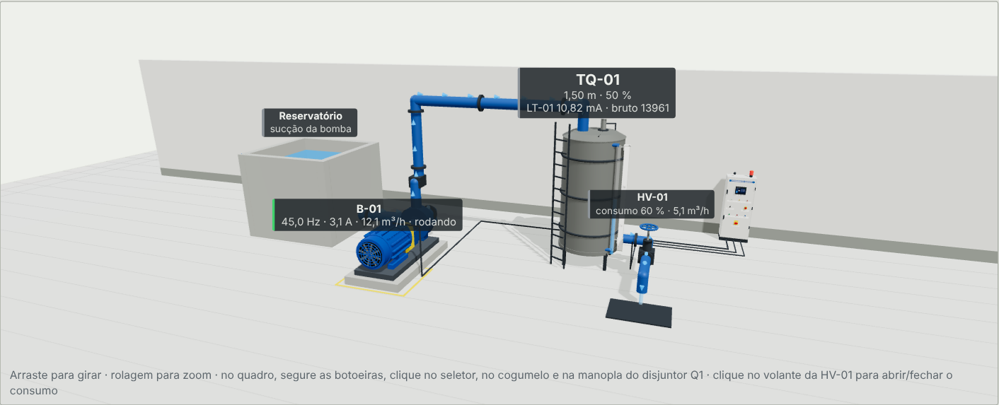

## O processo em uma página

Uma bomba **B-01**, acionada por um inversor, tira água de um reservatório e enche o tanque **TQ-01** (2 m² de área, 3 m de altura, 6 m acima do reservatório). O tanque alimenta um consumidor por gravidade através da válvula manual **HV-01**, que o instrutor abre e fecha — é a perturbação. O programa do CLP decide a velocidade da bomba olhando o nível.

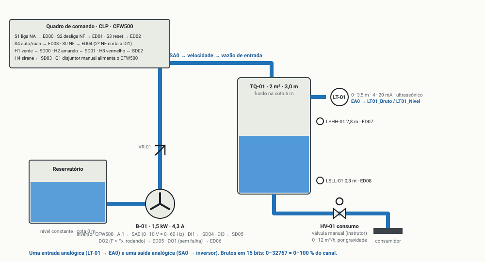

| Elemento | Sinal | Canal / variável |
|---|---|---|
| LT-01, nível do tanque | transmissor ultrassônico 0–3,5 m, 4–20 mA | EA0 → `LT01_Bruto` (contagem do A/D, 0–32767) |
| Referência do inversor | 0–10 V = 0–60 Hz na AI1 do CFW500 | SA0 ← `Ref_Bruto` (contagem do D/A, 0–32767) |
| LSHH-01 / LSLL-01 | boias, contato NA, 2,8 m e 0,3 m | ED07 / ED08 |
| S1 liga, S2 desliga (NF), S3 reset, S4 auto/manual, S0 emergência (NF) | botoeiras de 22 mm | ED00–ED04 |
| CFW500 DO2 "rodando" e DO1 "sem falha" | relés do inversor | ED05 / ED06 |
| H1, H2, H3, H4 | sinaleiros e sirene | SD00–SD03 |
| CFW500 DI1 gira/para, DI3 reset | entradas do inversor | SD04 / SD05 |
| Q1 | disjuntor-motor que alimenta o inversor — manual, no quadro (manopla na porta) | — (não é do CLP) |

Números que valem decorar: a bomba a 60 Hz manda **18,5 m³/h**; a 45 Hz (75 %), **12 m³/h**; abaixo de uns **36 Hz não entra água**, porque a bomba não vence os 6 m de altura mais a coluna do tanque. Com a HV-01 toda aberta saem até 12 m³/h. Cada 2 m³ são 1 m de nível.

## Como o sinal viaja: do sensor ao seu programa e de volta

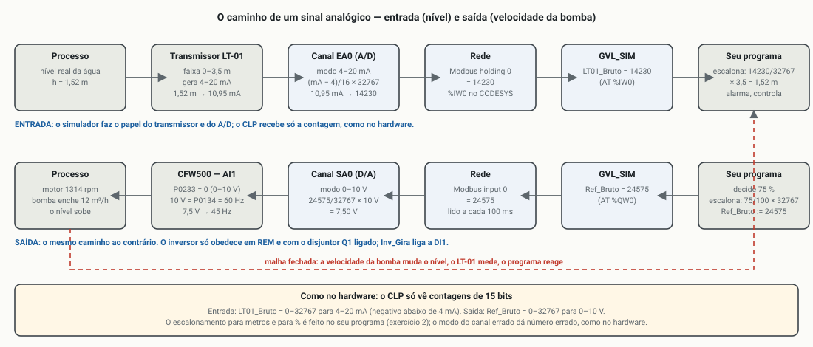

**Entrada.** O tanque tem 1,52 m de água. O LT-01 está calibrado para 0–3,5 m e gera 4–20 mA: 4 + 16 × (1,52 / 3,5) = **10,95 mA**. O canal EA0 do CLP, configurado em 4–20 mA, converte em contagem de 15 bits: (10,95 − 4) / 16 × 32767 = **14230**. Esse número chega ao CLP na variável **`GVL_SIMULADOR.LT01_Bruto`** (Modbus: holding register 0 → `%IW0`). Como num CLP real, o programa recebe **só a contagem** e faz o escalonamento: 14230 / 32767 × 3,5 = 1,52 m.

**Saída.** Seu programa decide 75 % e escala para a contagem do D/A: **`GVL_SIMULADOR.Ref_Bruto := 24575`** (75 % de 32767). O simulador lê (input register 0 → `%QW0`) e converte no sinal do canal SA0, 0–10 V: **7,50 V**. Esse sinal entra na AI1 do CFW500; o inversor está em P0233 = 0 (0–10 V) e P0134 = 60 Hz, logo 7,5 V = **45 Hz**. O motor acelera pela rampa de 2 s, a bomba manda 12 m³/h, o nível sobe, o LT-01 mede — e a malha fecha.

Dois detalhes como na vida real: o inversor só obedece em **REM** e com o **disjuntor Q1 ligado**; e se o canal estiver no **modo errado** (EA0 em 0–20 mA com transmissor 4–20 mA), a contagem sai errada — 1,52 m viram 17938 e o escalonamento daria 1,92 m, enquanto o visor do tanque mostra 1,52 m. É assim que se descobre o erro de configuração.

## Variáveis e endereços

**Não há vetores.** Cada sinal é **uma variável com nome próprio e um endereço**. No CLP todas ficam na lista de variáveis globais **`GVL_SIMULADOR`** (arquivo `mastertool/GVL_SIMULADOR.st`), com os mesmos nomes da tela, e cada uma é ligada ao seu canal do *Modbus TCP Slave Device* pela coluna *Variable* da aba de mapeamento (passo a passo em *Interligar*). Não há variável REAL na troca: o canal analógico vai em **contagem** (0–32767), a velocidade da IHM em **%** (75 = 75 %) e o setpoint e o nível da IHM em **centímetros** (200 = 2,00 m). As conversões ficam no programa (três linhas, em *Escalonamento na prática*).

### O simulador escreve, o CLP lê

| Variável (`GVL_SIMULADOR`) | Tipo | Modbus | CODESYS | Significado |
|---|---|---|---|---|
| `S1_Liga` | BOOL | coil 0 | `%IX8.0` | botoeira S1 liga (NA): 1 enquanto pressionada |
| `S2_Desliga_NF` | BOOL | coil 1 | `%IX8.1` | botoeira S2 desliga (**NF**): 1 em repouso, 0 pressionada |
| `S3_Reset` | BOOL | coil 2 | `%IX8.2` | botoeira S3 reset (NA) |
| `S4_Auto` | BOOL | coil 3 | `%IX8.3` | seletor: 1 automático, 0 manual |
| `S0_Emerg_NF` | BOOL | coil 4 | `%IX8.4` | emergência (**NF**): 1 destravado, 0 acionado (o 2º NF corta a DI1 do inversor por hardware) |
| `Inv_Rodando` | BOOL | coil 5 | `%IX8.5` | relé DO2 do CFW500 (F > Fx): acima de 3 Hz |
| `Inv_OK` | BOOL | coil 6 | `%IX8.6` | relé DO1 do CFW500 (sem falha): 0 = falha ou sem alimentação |
| `LSHH` | BOOL | coil 7 | `%IX8.7` | nível acima de 2,8 m |
| `LSLL` | BOOL | coil 8 | `%IX9.0` | nível abaixo de 0,3 m |
| `LT01_Bruto` | INT | holding 0 | `%IW0` | nível, contagem 0–32767 = 4–20 mA = 0–3,5 m; negativo abaixo de 4 mA |
| `HB_Sim` | UINT | holding 1 | `%IW1` | heartbeat do simulador, +1/s |
| `IHM_Velocidade` | INT | holding 2 | `%IW2` | IHM: velocidade pedida em manual, em % (0–100) |
| `IHM_Setpoint` | INT | holding 3 | `%IW3` | IHM: setpoint de nível para o automático, em cm (200 = 2,00 m) |

### O CLP escreve, o simulador lê

| Variável (`GVL_SIMULADOR`) | Tipo | Modbus | CODESYS | Significado |
|---|---|---|---|---|
| `H1` · `H2` · `H3` · `H4` | BOOL | discrete 0 · 1 · 2 · 3 | `%QX6.0`–`%QX6.3` | sinaleiro verde, amarelo, vermelho e sirene |
| `Inv_Gira` | BOOL | discrete 4 | `%QX6.4` | DI1 do CFW500: gira (rampa P0100, 2 s); 0 para (rampa P0101, 2 s) |
| `Inv_Reset` | BOOL | discrete 5 | `%QX6.5` | DI3 do CFW500: borda de subida reseta falha |
| `Ref_Bruto` | INT | input 0 | `%QW0` | referência, contagem 0–32767 = 0–10 V = 0–60 Hz |
| `HB_CLP` | UINT | input 1 | `%QW1` | heartbeat do CLP, +1 a cada 0,5 s |
| `IHM_Nivel` | INT | input 2 | `%QW2` | nível que a IHM mostra, em cm (152 = 1,52 m) |

### Variáveis internas do CLP (não vão para a rede)

| Variável (`GVL_SIMULADOR`) | Tipo | Significado |
|---|---|---|
| `IHM_Nivel_Real` | REAL | nível do tanque em metros (`IHM_Nivel` / 100) — é o que o automático compara |
| `IHM_Nivel_SP_Real` | REAL | nível que o operador envia através da IHM, já convertido para metros (`IHM_Setpoint` / 100) |
| `IHM_Nivel_SP_Liga` | REAL | liga a bomba abaixo deste nível: `IHM_Nivel_SP_Real − 0,10` |
| `IHM_Nivel_SP_Desl` | REAL | desliga a bomba acima deste nível: `IHM_Nivel_SP_Real + 0,10` |

Os valores são os mesmos em qualquer protocolo (Modbus, OPC UA ou OPC DA). A tabela completa, com a notação clássica (00001, 40001…), o valor ao vivo e um botão para copiar, está na seção *Variáveis e endereços* da tela.

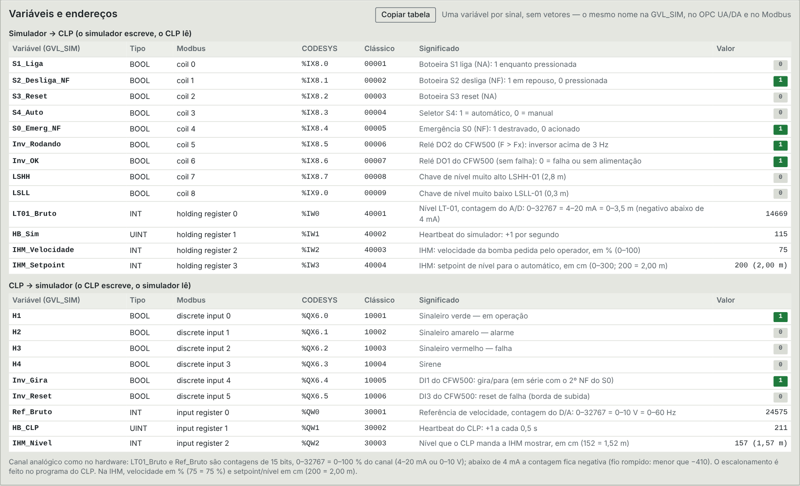

## Escalonamento na prática

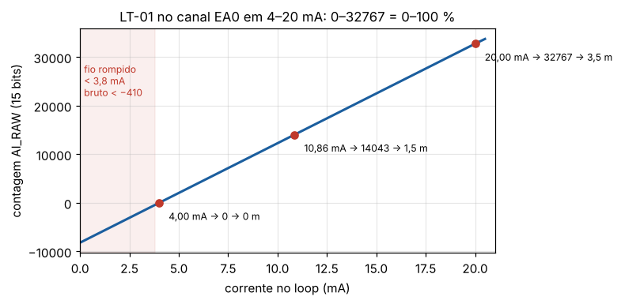

O canal analógico chega e sai em contagem de 15 bits. São **três cálculos** no programa, exatamente estes:

```iecst
(* saída: velocidade pedida na IHM (%) -> contagem do D/A (0..32767 = 0..10 V = 0..60 Hz) *)
GVL_SIMULADOR.Ref_Bruto := REAL_TO_INT(GVL_SIMULADOR.IHM_Velocidade / 100.0 * 32767.0);

(* entrada: contagem do A/D do LT-01 (0..32767 = 0..3,5 m) -> nível em cm para a IHM *)
GVL_SIMULADOR.IHM_Nivel := REAL_TO_INT((GVL_SIMULADOR.LT01_Bruto) / 32767.0 * 350);

(* IHM: setpoint em cm -> metros (REAL), para o controle automático *)
GVL_SIMULADOR.IHM_Nivel_SP_Real := INT_TO_REAL(GVL_SIMULADOR.IHM_Setpoint) / 100.0;
```

A conta de cada um, para conferir com a tela:

| `LT01_Bruto` | corrente | nível | `IHM_Nivel` (cm) |
|---|---|---|---|
| 0 | 4,00 mA | 0,00 m | 0 |
| 9362 | 8,57 mA | 1,00 m | 100 |
| 14043 | 10,86 mA | 1,50 m | 150 |
| 23405 | 15,43 mA | 2,50 m | 250 |
| 26214 | 16,80 mA | 2,80 m (LSHH) | 280 |
| 32767 | 20,00 mA | 3,50 m | 350 |

| `IHM_Velocidade` | `Ref_Bruto` | SA0 | CFW500 | Vazão |
|---|---|---|---|---|
| 0 % | 0 | 0 V | 0 Hz | 0 |
| 60 % | 19660 | 6,0 V | 36 Hz | ~7 m³/h |
| 75 % | 24575 | 7,5 V | 45 Hz | ~12 m³/h |
| 100 % | 32767 | 10,0 V | 60 Hz | ~18,5 m³/h |

| `IHM_Setpoint` | `IHM_Nivel_SP_Real` |
|---|---|
| 150 | 1,50 m |
| 200 | 2,00 m |
| 250 | 2,50 m |

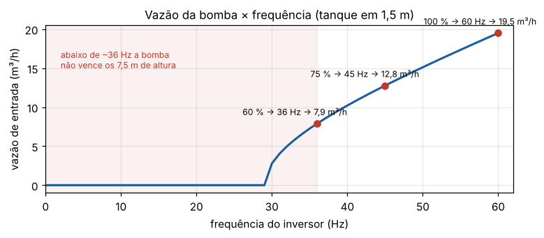

**Fio rompido.** Um transmissor sadio nunca vai abaixo de 4 mA; fio partido dá 0 mA e a contagem vai a −8192. Detecte abaixo de 3,8 mA, ou seja `GVL_SIMULADOR.LT01_Bruto < -410`, trate como falha de instrumento e pare o automático — um programa ingênuo leria −0,875 m, acharia o tanque vazio e ligaria a bomba no máximo.

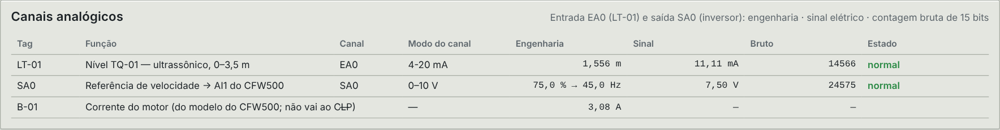

## A IHM do operador

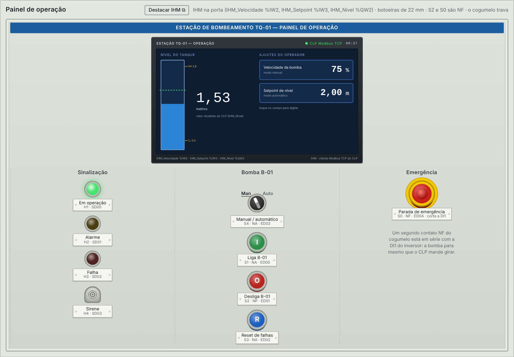

A IHM de 7" fica montada na porta do quadro, acima das botoeiras — no 3D, clicar nela abre a mesma IHM em uma janela flutuante. Ela é um segundo cliente Modbus do CLP, sem nenhum fio: **não enxerga o transmissor nem o inversor**, só troca três registradores com o CLP. O operador toca no campo e digita no teclado numérico, como numa IHM de verdade.

| Sentido | Modbus | CODESYS | Conteúdo |
|---|---|---|---|
| IHM → CLP | holding 2 | `%IW2` | `IHM_Velocidade`: velocidade da bomba em manual, em % (60 = 60 %) |
| IHM → CLP | holding 3 | `%IW3` | `IHM_Setpoint`: setpoint de nível para o automático, em cm (250 = 2,50 m) |
| CLP → IHM | input 2 | `%QW2` | `IHM_Nivel`: nível que o CLP quer mostrar, em cm (147 = 1,47 m) |

No programa, a IHM entra nos três cálculos de *Escalonamento na prática*: a velocidade digitada vira `Ref_Bruto` (em manual e em automático), o setpoint vira `IHM_Nivel_SP_Real` (e os limites `IHM_Nivel_SP_Liga`/`IHM_Nivel_SP_Desl` do liga-desliga, exercício 4), e o nível medido volta para a IHM em `IHM_Nivel`.

A lição: se o programa esquecer de escrever `IHM_Nivel`, a IHM mostra "—", porque ela só sabe o que o CLP manda; e o que o operador digita só vira 0–10 V na SA0 se o CLP quiser. A linha tracejada verde no tanque da IHM é o setpoint. O botão **IHM ⧉** (ou um clique na IHM do quadro 3D) destaca a IHM em uma janela flutuante: arraste pela barra para posicionar e pelo canto inferior direito para redimensionar (de 300 a 1100 px de largura; a tela da IHM acompanha). Duplo clique no canto volta ao tamanho padrão; o simulador lembra a última largura.

## O inversor na malha

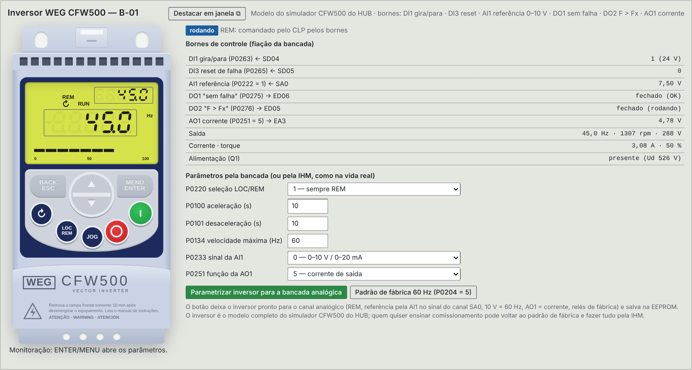

O CFW500 é o modelo do simulador CFW500 do HUB (motor, rampas, proteções, IHM real, EEPROM). O botão **Parametrizar inversor para a bancada analógica** grava tudo de uma vez, e o simulador já faz isso na primeira energização. Se você voltar o inversor para o padrão de fábrica, ou estiver numa bancada real, esta é a tabela a programar:

### Parâmetros a programar no CFW500

| Parâmetro | Nome | Valor | Por quê |
|---|---|---|---|
| **P0220** | Seleção da fonte LOC/REM | **1** = sempre remoto | o CLP comanda; em LOC só a IHM do inversor manda |
| **P0222** | Referência de velocidade em REM | **1** = AI1 | a velocidade vem da saída analógica SA0 do CLP |
| **P0227** | Gira/para em REM | **1** = entradas digitais | o gira/para vem da DI1 |
| **P0233** | Sinal da entrada AI1 | **0** = 0–10 V | igual ao modo do canal SA0 do CLP |
| **P0133** | Velocidade mínima | **3,0 Hz** | abaixo disso o inversor não desce, mesmo com 0 V na AI1 |
| **P0134** | Velocidade máxima | **60,0 Hz** | 10 V na AI1 = 60 Hz |
| **P0263** | Função da DI1 | **1** = gira/para | ligada em `Inv_Gira` |
| **P0265** | Função da DI3 | **20** = reset de falha | ligada em `Inv_Reset` |
| **P0275** | Função da DO1 (relé) | **13** = sem falha | vai para `Inv_OK` |
| **P0276** | Função da DO2 (relé) | **2** = F > Fx | vai para `Inv_Rodando` (acima de 3 Hz, P0288) |
| **P0100** | Tempo de aceleração | **2,0 s** | de 0 a 60 Hz em 2 s: a bomba responde rápido à referência |
| **P0101** | Tempo de desaceleração | **2,0 s** | de 60 a 0 Hz em 2 s ao tirar o `Inv_Gira` |

Na IHM do CFW500: **MENU/ENTER** → grupo **BASIC** (ou **I/O**) → ▲▼ até o parâmetro → **ENTER** → ▲▼ até o valor → **ENTER**. Com o motor girando, parâmetros de configuração não aceitam mudança: pare a bomba antes.

O que o programa precisa saber: a **alimentação do inversor é manual**, pelo disjuntor-motor **Q1** no quadro (manopla na porta, botão no *Quadro elétrico*) — o CLP não liga nem desliga o inversor. Com Q1 desligado o inversor está apagado (`Inv_OK` = 0) e, ao religar, leva 1,2 s de boot. A **emergência S0** tem dois contatos NF: um vai a `S0_Emerg_NF` (o CLP sabe) e o outro está **em série com a DI1** do inversor, então a bomba para pela rampa mesmo que o programa continue mandando girar. Quem fecha o relé "rodando" é o inversor depois de passar de 3 Hz — espere `Inv_Rodando` em vez de supor; uma falha abre o relé DO1 (`Inv_OK` = 0) e o reset é por `Inv_Reset` ou pela tecla O.

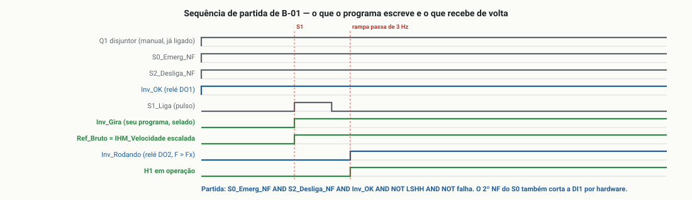

## Como o processo se comporta

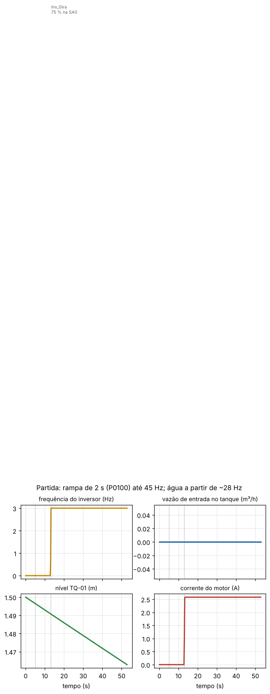

Q1 ligado (inversor já energizado) → `Inv_Gira` com 75 % → rampa de 2 s (0 a 45 Hz em 1,5 s) → a água só começa a entrar quando passa de ~28 Hz → 12 m³/h a 45 Hz. Com o consumo em 60 % saem ~5 m³/h, então o nível sobe 7 m³/h ÷ 2 m² = **5,8 cm/min**. Use a velocidade 5× ou 10× da tela para não esperar.

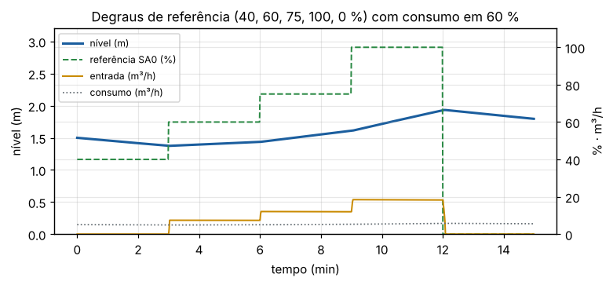

A referência manda na vazão de entrada; a HV-01 (instrutor) manda no consumo. Com 60 % de referência (36 Hz) entram ~7 m³/h — quase o mesmo que sai com a HV-01 em 60 %: o nível fica parado. É o ponto de equilíbrio que o exercício de controle proporcional vai encontrar sozinho.

| Situação | O que acontece | O que o programa deve ver |
|---|---|---|
| Nível chega ao ladrão (2,95 m) | o excesso sai pelo extravasor (ladrão) atrás do tanque, com jato e aviso "TRANSBORDANDO"; o nível para em ~2,97 m | `LSHH` em 2,8 m deveria ter parado a bomba antes |
| Consumo maior que a entrada | o nível cai até a LSLL | ED08 em 0,3 m |
| Fio rompido no LT-01 | 0 mA, bruto −8192 | parar o automático e alarmar |
| LT-01 travado | o valor congela com o nível mudando | cruzar com LSHH/LSLL |
| Falha no inversor | F0070, ED06 vai a 0, motor para por inércia | desligar SD04, sinalizar, permitir reset |
| Perda de comunicação | `HB_Sim` congela | estado seguro em 3 s |

## Interligar

### Modbus TCP (CODESYS Control Win ou XP325) — o caminho principal

1. No CODESYS: dispositivo → *Add Device* → **Ethernet** → *Add Device* → **Modbus TCP Slave Device**. Na configuração: porta **502**, Unit ID **1**, **Holding Registers 4, Input Registers 3, Coils 9, Discrete Inputs 6** — exatamente o que a estação usa.
2. Crie a lista de variáveis globais **`GVL_SIMULADOR`** e cole o conteúdo de `mastertool/GVL_SIMULADOR.st` (as 22 variáveis da tabela, sem `AT`, mais a interna `IHM_Nivel_SP_Real`).
3. Abra a aba **Modbus TCP Slave Device I/O Mapping** e ligue cada canal à sua variável: duplo clique na coluna *Variable* → botão `…` → `Application.GVL_SIMULADOR.<nome>`. A ordem é a da tabela: Holding Registers[0..3] = `LT01_Bruto`, `HB_Sim`, `IHM_Velocidade`, `IHM_Setpoint`; Input Registers[0..2] = `Ref_Bruto`, `HB_CLP`, `IHM_Nivel`; Coils[0].Bit0..7 e Coils[1].Bit0 = `S1_Liga` … `LSLL`; Discrete Inputs[0].Bit0..5 = `H1` … `Inv_Reset`. O ícone de cada linha tem que ser o de "variável existente" (sem estrela amarela) e o endereço fica riscado — é o normal. Deixe **Always update variables** ativado.
4. Crie o programa `PRG_TQ01` com o conteúdo de `mastertool/PRG_TQ01_GVL_SIMULADOR.st` e chame-o na **MainTask**.
5. Compile, Login, Download, Run. No simulador: *Conectar ao CLP* → **Modbus TCP** → IP (127.0.0.1 no mesmo PC; Control Win no SIM-HUB: 192.168.100.10) → porta 502 → *Conectar*.

Cuidados: as variáveis ligadas pela coluna *Variable* **não podem ter `AT`** (o CODESYS acusa "map to existing variable with address is not allowed"). Se preferir o contrário — sem mapear canal por canal —, use `mastertool/GVL_SIM.st`, que tem `AT` em cada variável (coils a partir de `%IX8.0` e discrete inputs a partir de `%QX6.0`, porque o CODESYS põe essas áreas depois dos registradores); nesse caso não use a coluna *Variable*. No XP325 real, o servidor é o **MODBUS Symbol Server** na NET 1, com as mesmas variáveis nos mesmos endereços.

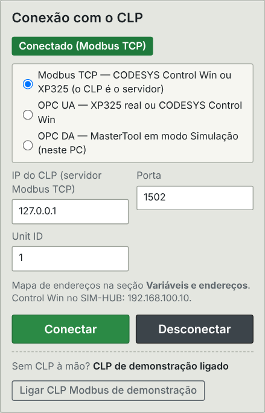

### OPC UA (XP325 ou Control Win)

GVL `GVL_SIMULADOR` (`mastertool/GVL_SIMULADOR.st`) exposta no Symbol Set / Configuração de Símbolos com OPC UA, e o seu programa na MainTask (sem `AT`: no OPC o simulador escreve direto nas variáveis). Acesso leitura e escrita para as variáveis da primeira tabela (o que o simulador escreve) e só leitura para as da segunda. Segurança de laboratório: anonymous permitido e comunicação em texto plano, depois desligue e ligue a CPU. No simulador, **OPC UA** → IP → 4840.

### OPC DA (MasterTool em modo Simulação, só neste PC)

O modo Simulação do MasterTool não tem rede, mas o servidor OPC DA do MasterTool enxerga a CPU simulada pela porta 11739 (é o caminho da Altus para FluidSIM e FactoryIO). Uma vez por PC: baixe o *Graybox OPC DA Auto Wrapper* (x86), copie `gbda_aut.dll` para `tools\opcda\` e rode `INSTALAR_OPCDA.bat` como administrador. A cada sessão: projeto com a `GVL_SIMULADOR` e Configuração de Símbolos compilada; Simulação, Login, Run; *Configuração do OPC* com IP 127.0.0.1 e porta 11739; no simulador, **OPC DA** → *Conectar*.

### Sem CLP

*Ligar CLP de demonstração* sobe um CLP falso (Modbus ou OPC UA) com os exercícios 1, 3 e 4 resolvidos — para conhecer o processo antes de programar.

## A tela

- **Estação (3D e sinótico):** arraste para girar, rolagem para zoom. O quadro é uma coluna de comando de 2 m com os dispositivos na zona de operação (botoeiras a 0,86 m, cogumelo e seletor a 1,10 m, sinaleiros a 1,33 m, IHM de 10" a 1,62 m). Botoeiras e sinaleiros são de 22 mm em tamanho real, então aproxime a câmera (preset *Quadro* ou rolagem) para operar; segure as botoeiras, clique no seletor e no cogumelo; clique no volante da HV-01 para abrir e fechar o consumo. Os eletrodutos no piso levam os sinais do quadro ao motor, ao LT-01 e às boias.
- **Medidores:** coluna de nível com as marcas HH e LL (a entrada) e indicador de frequência do inversor (a saída, com a faixa vermelha abaixo de 36 Hz onde não entra água); tendência de 5 min com nível, referência, Hz, entrada e consumo.
- **Som:** a sirene `H4` toca de verdade (tom bitonal). O navegador só libera áudio depois do primeiro clique na página — o botão **🔈/🔊/🔇** no topo mostra o estado e liga/desliga o som.
- **Painel de operação:** a porta do quadro em 2D, igual à 3D, com a IHM do operador montada acima das botoeiras.
- **Inversor:** IHM real, bornes ao vivo, parâmetros e o botão de parametrização; **Inversor ⧉** destaca em janela flutuante para operar olhando o 3D.
- **Canais analógicos:** LT-01 e SA0 nos três formatos — engenharia, sinal elétrico e contagem bruta — com o estado (normal, fio rompido, travado, inversor em LOC).
- **Quadro elétrico:** XP325 com os LEDs de cada ED e SD, e o disjuntor-motor Q1 do inversor (clique para ligar/desligar).
- **Bancada:** modo dos canais EA0 e SA0 (como no MasterTool/CODESYS), e fundo de escala do A/D.
- **Variáveis e endereços:** GVL e mapa Modbus com o estado ao vivo.
- **Diagrama de ligação** (botão no topo): a fiação com o estado de cada ponto.


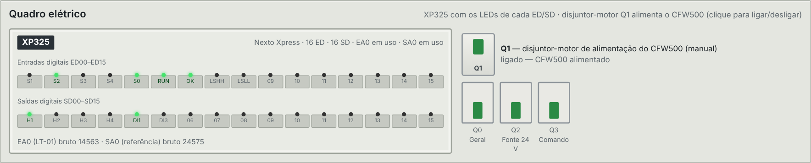
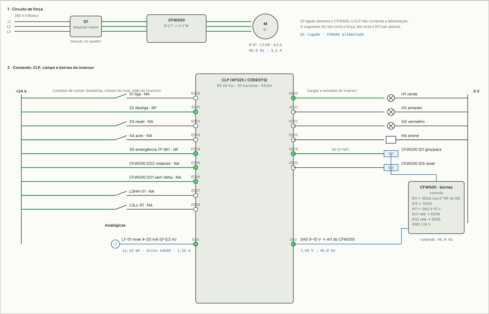

## Laboratório de histerese

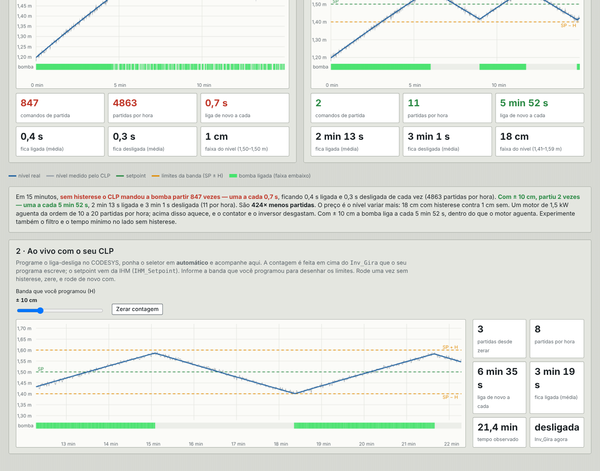

O botão **Laboratório de histerese**, no topo da tela, abre uma página para mostrar ao aluno por que todo liga-desliga precisa de banda morta.

**1 · Comparação simulada.** O simulador roda o mesmo tanque duas vezes, acelerado, com um CLP liga-desliga: à esquerda **sem histerese** (liga abaixo do setpoint, desliga acima) e à direita **com histerese** (liga abaixo de SP − H, desliga acima de SP + H e, entre os dois, mantém o estado). Os gráficos mostram o nível real, o nível medido (com o ruído do transmissor), o setpoint, os limites da banda e uma faixa verde com os momentos em que a bomba está ligada; embaixo, as contas: comandos de partida, partidas por hora, **de quanto em quanto tempo a bomba liga de novo**, quanto tempo ela fica ligada e desligada em média, e quanto o nível varia. Os números ficam verdes até 20 partidas por hora (o que um motor desse porte aguenta), âmbar até 60 e vermelhos acima disso. Com os valores padrão (SP 2,00 m, H = ± 10 cm, consumo 60 %), em 15 minutos o lado sem histerese manda a bomba partir milhares de vezes — o ruído de milímetros cruza o setpoint o tempo todo — e o lado com histerese, duas ou três. Dá para mexer no setpoint, na banda, no consumo, na velocidade, ligar um **filtro** na medição, impor um **tempo mínimo** ligado/desligado, pôr um **TON de confirmação** em cada comparação, usar o **nível em cm inteiro** (como o `IHM_Nivel`) ou tirar o ruído. Para comparar com o programa do aluno, reproduza o que ele faz e clique em **Usar consumo e velocidade da estação**: com SP 1,50 m, ± 2 cm, TON de 2 s, nível em cm, consumo 80 % e velocidade 80 %, o laboratório dá ~57 s ligada e ~60 s desligada — o mesmo que um programa em Ladder com esses valores mede ao vivo. Repare que o TON sozinho já filtra muito: com ele, até o lado "sem histerese" cai de milhares para dezenas de partidas por hora — por isso, na aula, tire o TON e deixe só a histerese. Com ± 10 cm e sem TON, nas mesmas condições, ficam ~10 partidas por hora, com a bomba ~3 minutos ligada e ~3 minutos desligada, e o nível entre 1,41 e 1,59 m.

**2 · Ao vivo com o seu CLP.** Com o programa do aluno rodando em automático, a página conta as partidas a partir do `Inv_Gira` e desenha os últimos 10 minutos com o setpoint da IHM e a banda que o aluno diz ter programado. A aula fica assim: programa sem histerese, roda alguns minutos, anota as partidas por hora; **Zerar contagem**; programa com histerese, roda de novo, compara. Embaixo do gráfico aparecem os **últimos períodos, um por um** ("ligada 19,2 s · desligada 17,1 s…"), para conferir com um cronômetro. Os botões de **escala de tempo** (30 min a 30 s, também nos gráficos simulados) aproximam o gráfico; abaixo de 1 min as marcas ficam em minutos:segundos.

## Instrutor

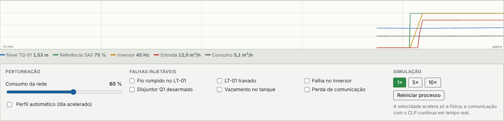

Consumo da HV-01 (slider ou perfil automático), fio rompido no LT-01, LT-01 travado, falha no inversor, disjuntor Q1 desarmado, vazamento no tanque, perda de comunicação; velocidade 1×, 5× e 10× (só a física) e reinício do processo.

## Trilha de exercícios

1. **Partida e parada com intertravamentos.** Permissão = `S2_Desliga_NF AND S0_Emerg_NF AND Inv_OK AND NOT LSHH`; selo com `S1_Liga`; `Inv_Gira` = ligado; `Ref_Bruto` = `IHM_Velocidade` escalada para 0–32767; nível de volta para a IHM; `H1` pelo retorno `Inv_Rodando`; falha memorizada em H3 até S3. Aprovação: S1 parte, S2 e S0 param, sem o inversor OK nada gira, H1 só acende com o retorno, mudar a velocidade na IHM muda os Hz, e a IHM mostra o nível. `PRG_TQ01_GVL_SIMULADOR.st` é a solução de referência (exercícios 1 e 4).
2. **Escalonamento da entrada e da saída.** Nível em metros a partir de `LT01_Bruto`; referência em % virando `Ref_Bruto`. Aprovação: os seus valores batem com a coluna *Engenharia* da tela em três pontos; depois troque o modo do canal EA0 na Bancada e explique a diferença.
3. **Alarmes e fio rompido.** L (0,5 m), LL (0,3 m ou ED08), H (2,6 m), HH (2,8 m ou ED07) com histerese de 5 cm e reconhecimento por S3; detecção de fio rompido bloqueando o automático. Aprovação: injete fio rompido com a bomba ligada e mostre a parada segura.
4. **Controle liga-desliga de nível com histerese** (use o *Laboratório de histerese* para comparar sem e com banda). No ST, calcule `IHM_Nivel_Real := TO_REAL(IHM_Nivel) / 100.0`, `IHM_Nivel_SP_Liga := IHM_Nivel_SP_Real - 0.10` e `IHM_Nivel_SP_Desl := IHM_Nivel_SP_Real + 0.10`. Em Ladder, três degraus: **(1)** `S4_Auto` NA · `S0_Emerg_NF` NA · `LSHH` NF · **LE** (`IHM_Nivel_Real` ≤ `IHM_Nivel_SP_Liga`) → **SET** `Inv_Gira`; **(2)** os mesmos contatos · **GE** (`IHM_Nivel_Real` ≥ `IHM_Nivel_SP_Desl`) → **RESET** `Inv_Gira`; **(3)** segurança, três contatos em paralelo — `S4_Auto` NF, `S0_Emerg_NF` NF, `LSHH` NA — → **RESET** `Inv_Gira`. Sem TON. A velocidade continua sendo a da IHM. `PRG_TQ01_GVL_SIMULADOR.st` é o equivalente em ST. Aprovação: com SP 1,50 m, o nível oscila entre 1,40 e 1,60 m, a bomba liga a cada poucos minutos (no máximo ~20 partidas por hora no *Laboratório de histerese → Ao vivo*), e apertar a emergência, passar para manual ou atuar a LSHH desliga a bomba e ela não volta sozinha.

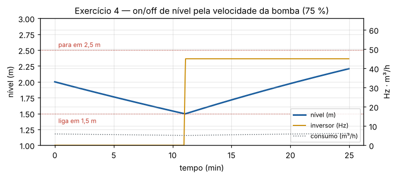

5. **Controle proporcional e PID de nível pela velocidade.** Setpoint vindo da IHM (`IHM_Setpoint`); saída limitada a 0–100 %; comece com `ref = 60 + Kp × (SP − PV)` e observe o erro em regime, depois adicione a integral (bloco PID do CODESYS/MasterTool). Aprovação: com o perfil de consumo automático, o nível fica a ±10 cm do setpoint e a bomba não para e liga toda hora.
6. **Proteções.** Bomba sem vazão (referência abaixo de 36 Hz por mais de 20 s em automático), LSLL, falha do inversor, perda de comunicação. Aprovação: cada falha injetada para a bomba, acende H3 e mostra a causa.

## Instalar, iniciar e atualizar

1. Descompacte a pasta inteira em um lugar com permissão de escrita.
2. `INSTALAR.bat`: Node.js se faltar, dependências, atalho.
3. `INICIAR_SIMULADOR.bat`: abre http://127.0.0.1:3050.
4. `TESTAR.bat`: testes automáticos, deve terminar em "0 falha(s)".

No HUB de simuladores, importe o .zip em *Adicionar e atualizar*. `config/` (conexão) e `server/data/` (EEPROM do inversor) são preservados.

## Problemas comuns

- **Porta 3050 em uso:** o simulador já está aberto.
- **O CLP não vê as botoeiras:** olhe os LEDs do XP325 no quadro elétrico; se acendem no simulador e não no CLP, o problema é a comunicação (coluna de conexão: fila, latência, último erro).
- **Escrevo na SA0 e nada gira:** disjuntor Q1 ligado, cogumelo S0 destravado (ele corta a DI1), inversor em REM (botão *Parametrizar inversor*), referência acima de 60 % para haver vazão. F00xx no display é falha: reset pela DI3 ou tecla O.
- **Bruto estranho:** modo do canal na Bancada contra o transmissor (4–20 mA) e contra a AI1 (0–10 V); fundo de escala do A/D do seu CLP.
- **OPC DA não conecta:** rode `INSTALAR_OPCDA.bat` e leia em qual passo parou.
