# Sensor ultrassônico VEGA: guia passo a passo

Um tanque com transmissor ultrassônico de nível (dados do VEGASON 61) que entrega 4–20 mA. No CLP você recebe a contagem do nível, faz a escala e programa os alarmes.

## Para quem é

Para quem vai **programar o CLP**. O processo foi feito enxuto de propósito: **uma variável**, a entrada analógica do nível. Não há bomba nem válvula para comandar: você mexe no nível pela Bancada do simulador e o seu programa lê, calcula e sinaliza.

Onde os alarmes aparecem é escolha sua. Você pode tratá-los só dentro do CLP, ou ligar o **retorno do CLP** e ver cinco sinaleiros e uma IHM no painel 3D do simulador, comandados pelo seu programa.

O simulador também funciona **sem CLP**, para a aula sobre o sensor: tempo de voo, zona morta, eco falso, temperatura e espuma.

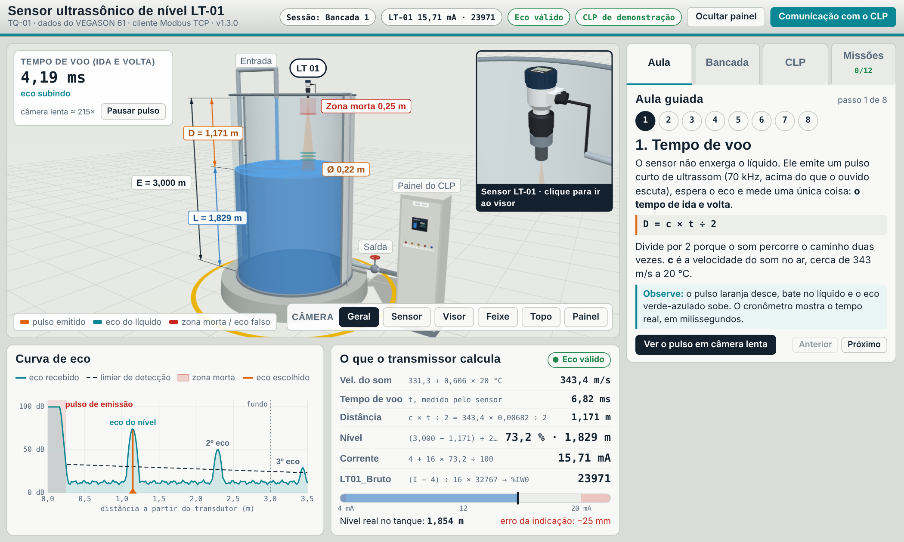

## O processo em uma página

| Elemento | O que faz | Sinal | Variável |
| --- | --- | --- | --- |
| Tanque TQ-01 | 3,00 m do sensor até o fundo; 100 % calibrado em 2,50 m | — | — |
| Transmissor LT-01 | Mede a distância até o líquido por ultrassom e entrega corrente | 4–20 mA, 2 fios | `LT01_Bruto` |
| Cartão analógico do CLP | Converte a corrente em contagem de 15 bits | 0–32767 | `%IW0` |
| Sinaleiros H1 a H5 (opcional) | Acendem com o que o seu programa mandar | 5 saídas digitais | `LALL_01`, `LAL_01`, `LAH_01`, `LAHH_01`, `Falha_LT01` |
| IHM do painel | Sem retorno: mostra o valor enviado pelo transmissor. Com retorno: o nível que o seu programa calculou | registrador | `Nivel_Pct` (opcional) |

Números que valem decorar:

- **4 mA = 0 = 0 %** e **20 mA = 32767 = 100 %**.
- **3,8 mA = −410**: abaixo disso é falha do transmissor ou cabo rompido, não é tanque vazio.
- **Cabo rompido = 0 mA = −8192**.
- Zona morta do sensor: **0,25 m**. Feixe: **11°**. Velocidade do som a 20 °C: **343,4 m/s**.

## Como o sinal viaja

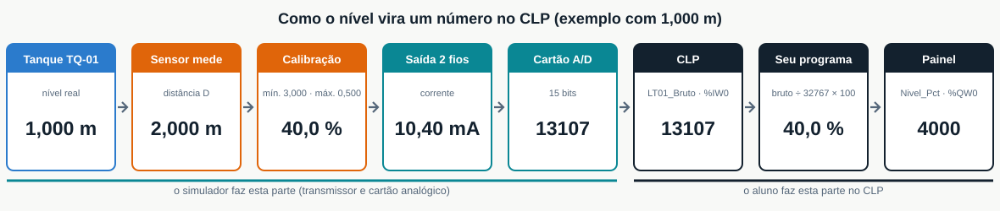

Com 1,000 m no tanque: o sensor mede 2,000 m de distância (tempo de voo de 11,65 ms), a calibração transforma em 40,0 %, a saída vai a 10,40 mA e o cartão analógico entrega **13107** em `%IW0`. O seu programa desfaz a conta (13107 ÷ 32767 × 100 = 40,0 %). Se o retorno do CLP estiver ligado, ele devolve 4000 em `%QW0`, porque o `Nivel_Pct` viaja multiplicado por 100.

Duas pegadinhas de campo que o simulador reproduz:

1. **22 mA não é detectável neste cartão.** O A/D satura em 32767 com 20 mA. Se o modo de falha do transmissor for 22 mA (ou 20,5 mA), o CLP lê 32767 e conclui "tanque cheio". Por isso o modo de falha de fábrica, **< 3,6 mA**, é o seguro aqui: ele dá -922, bem abaixo de −410.
2. **Nível baixo não é falha.** Tanque vazio dá 0, nunca um número negativo grande. Só trate como falha o que estiver abaixo de −410.

## Mapa de dados

O simulador é o **cliente** Modbus TCP e o CLP é o **servidor**. Uma variável por sinal, sem vetores. Cada tabela Modbus conta a partir de 0.

| Variável | Sentido | Tipo | Tabela Modbus | Endereço | Clássico | CODESYS | Escala | O que é |
| --- | --- | --- | --- | --- | --- | --- | --- | --- |
| `LT01_Bruto` | simulador → CLP | INT | holding register (FC16) | 0 | 40001 | `%IW0` | 1 | Nível LT-01, contagem do A/D: 0–32767 = 4–20 mA = 0–100 % (negativo abaixo de 4 mA; cabo rompido = −8192) |
| `LALL_01` | CLP → simulador | BOOL | discrete input (FC2) | 0 | 10001 | `%QX0.0` | 1 | Alarme de nível muito baixo (sinaleiro H1) |
| `LAL_01` | CLP → simulador | BOOL | discrete input (FC2) | 1 | 10002 | `%QX0.1` | 1 | Alarme de nível baixo (sinaleiro H2) |
| `LAH_01` | CLP → simulador | BOOL | discrete input (FC2) | 2 | 10003 | `%QX0.2` | 1 | Alarme de nível alto (sinaleiro H3) |
| `LAHH_01` | CLP → simulador | BOOL | discrete input (FC2) | 3 | 10004 | `%QX0.3` | 1 | Alarme de nível muito alto (sinaleiro H4) |
| `Falha_LT01` | CLP → simulador | BOOL | discrete input (FC2) | 4 | 10005 | `%QX0.4` | 1 | Falha do transmissor ou do laço 4–20 mA (sinaleiro H5) |
| `Nivel_Pct` | CLP → simulador | REAL | input register (FC4) | 0 | 30001 | `%QW0` | × 100 | Nível calculado pelo CLP em % (Modbus: × 100; 4000 = 40,00 %). É o que a IHM do painel mostra |

Só a primeira linha é obrigatória. As outras seis são o **retorno do CLP**, que você liga ou desliga na aba CLP (veja a próxima seção).

## Sinaleiros no painel: o retorno do CLP (opcional)

Na aba **CLP** há a chave **Sinaleiros no painel (retorno do CLP)**. Ela vale só para a sua sessão e fica gravada.

| Chave | O que o simulador faz | O que o CLP precisa ter | No painel 3D |
| --- | --- | --- | --- |
| Desligada (padrão) | Só escreve o `LT01_Bruto`. Não lê nada | 1 holding register | Sem sinaleiros. A IHM mostra o valor que o transmissor envia (%, mA e contagem) |
| Ligada | Escreve o `LT01_Bruto` e lê os 5 sinaleiros e o `Nivel_Pct` | 1 holding, 1 input register e 8 discrete inputs | Cinco sinaleiros, e a IHM passa a mostrar o `Nivel_Pct` calculado pelo seu programa |

Use desligada quando os alarmes ficam só no CLP (lâmpadas na visualização do CODESYS, por exemplo). Use ligada quando quiser ver o resultado no painel do simulador ou cumprir as missões de alarme. O botão **Ligar CLP de demonstração** liga a chave sozinho.

## Lista de parâmetros do transmissor

Ficam na aba **Bancada**, em "Parâmetros do transmissor". As duas calibrações são distâncias medidas a partir da borda inferior do transdutor (o plano de referência).

| Parâmetro | Fábrica | Faixa | O que faz |
| --- | --- | --- | --- |
| Calibração mín. | 3,000 m | 0,250 a 5,000 m | Distância que corresponde a 0 % (4 mA) |
| Calibração máx. | 0,500 m | 0,250 a 5,000 m | Distância que corresponde a 100 % (20 mA) |
| Atenuação | 0 s | 0 a 999 s | Filtro da medição, em segundos |
| Modo de falha | < 3,6 mA | < 3,6 mA · Manter valor · 20,5 mA · 22 mA | Corrente de saída quando não há valor de medição |
| Supressão de sinal falso | Desligada | Desligada · Ligada | Ignora os ecos fixos gravados (obstáculos do tanque) |
| Correção de temperatura | Ligada | Desligada · Ligada | Didático: no aparelho real é fixa, sempre ligada |

Se a calibração mín. e a máx. ficarem a menos de 10 mm uma da outra, o transmissor acusa **E017** (faixa de calibração pequena demais).

## Escalonamento na prática

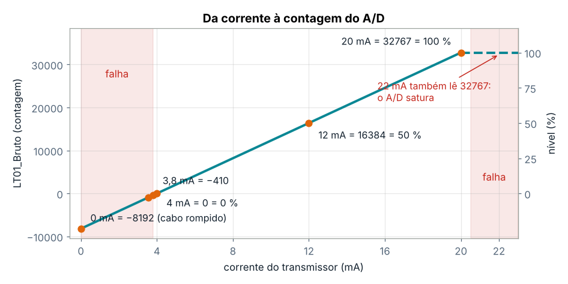

A conta do cartão analógico (feita pelo simulador):

```
LT01_Bruto = (I − 4) ÷ 16 × 32767
```

A conta do seu programa:

```
rPct := INT_TO_REAL(GVL_SIM.LT01_Bruto) / 32767.0 * 100.0;
```

Tabela de referência, conferida no simulador a 20 °C:

| Nível real | Distância D | Tempo de voo | Nível | Corrente | `LT01_Bruto` |
| --- | --- | --- | --- | --- | --- |
| 0,00 m | 3,00 m | 17,47 ms | 0 % | 4,00 mA | 0 |
| 0,25 m | 2,75 m | 16,02 ms | 10 % | 5,60 mA | 3277 |
| 0,50 m | 2,50 m | 14,56 ms | 20 % | 7,20 mA | 6553 |
| 1,00 m | 2,00 m | 11,65 ms | 40 % | 10,40 mA | 13107 |
| 1,25 m | 1,75 m | 10,19 ms | 50 % | 12,00 mA | 16384 |
| 2,00 m | 1,00 m | 5,82 ms | 80 % | 16,80 mA | 26214 |
| 2,25 m | 0,75 m | 4,37 ms | 90 % | 18,40 mA | 29490 |
| 2,50 m | 0,50 m | 2,91 ms | 100 % | 20,00 mA | 32767 |

Fora da faixa: 3,55 mA (modo de falha < 3,6 mA) = **-922**; 3,8 mA = **-410**; 0 mA = **-8192**; 20,5 mA e 22 mA = **32767** (saturado).

## Alarmes com histerese

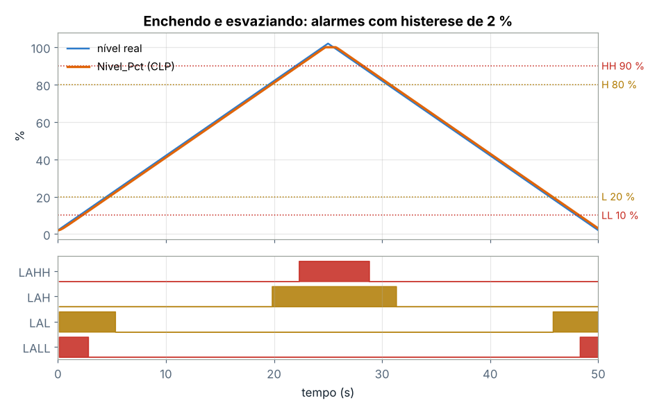

| Alarme | Liga | Desliga | Sinaleiro |
| --- | --- | --- | --- |
| `LAHH_01` muito alto | ≥ 90 % | < 88 % | H4 |
| `LAH_01` alto | ≥ 80 % | < 78 % | H3 |
| `LAL_01` baixo | ≤ 20 % | > 22 % | H2 |
| `LALL_01` muito baixo | ≤ 10 % | > 12 % | H1 |

Sem a histerese de 2 %, o alarme fica piscando quando o nível para em cima do limite. No gráfico, o tanque enche e esvazia a 0,10 m/s: o LAH liga em 80,2 % e só desliga em 77,8 %.

## Falhas: perda de eco e cabo rompido

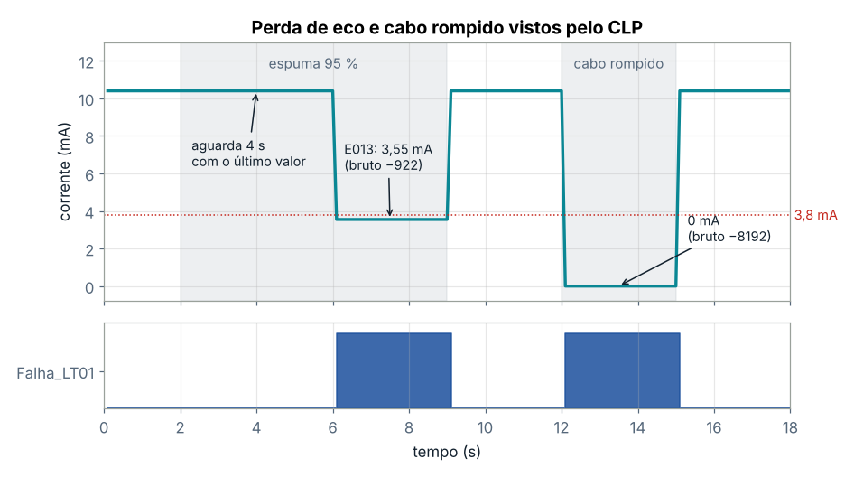

| Situação | O que o transmissor faz | O que chega no CLP | O que o programa deve fazer |
| --- | --- | --- | --- |
| Espuma densa (eco abaixo do limiar) | Segura o último valor por 4 s e depois mostra **E013** | 3,55 mA = -922 | `Falha_LT01` = 1, alarmes de nível apagados |
| Cabo do laço rompido | Apaga (dois fios: sem laço, sem alimentação) | 0 mA = -8192 | `Falha_LT01` = 1 |
| Modo de falha em 22 mA, sem eco | Mostra E013 e manda 22 mA | 32767 (saturado) | Não há como detectar: evite este modo neste cartão |

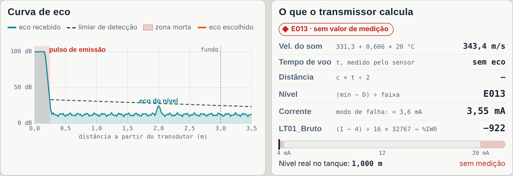

## Como o sensor se comporta

| Situação na Bancada | O que acontece | O que o CLP enxerga |
| --- | --- | --- |
| Nível 0,80 m com obstáculo no feixe | O eco do tubo (a 1,20 m) chega antes: indicação presa em 1,80 m | 72 % fixos, sem falha. O CLP não tem como saber |
| O mesmo, com supressão de sinal falso | O limiar cobre o eco fixo: volta a 0,80 m | 32 % |
| 50 °C com a correção de temperatura desligada | Distância sai 5 % menor: erro de +101 mm com 1,00 m reais | 44,0 % em vez de 40,0 % |
| Nível 2,85 m (dentro da zona morta) | O eco some no pulso de emissão e o sensor agarra o 2º eco: indica 2,70 m | 100 % com o tanque quase transbordando |

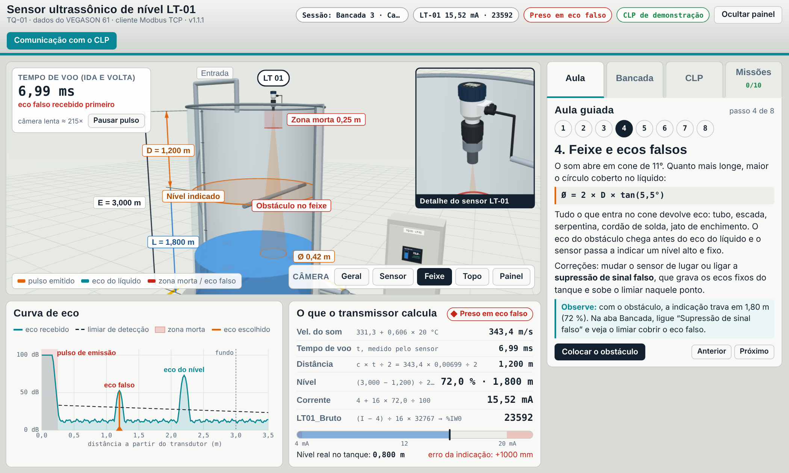

Este é o motivo de a proteção contra transbordo usar uma chave de nível separada e de o 100 % ficar abaixo da zona morta.

## Parte 1: abrir o simulador e entrar na sua sessão

1. No HUB: **Dispositivos** → **Sensor ultrassônico VEGA** → **Iniciar**. Fora do HUB: clique duas vezes em `INICIAR_SIMULADOR.bat`.
2. A tela pede a **sua sessão**. Digite o seu nome ou a bancada e clique em **Criar e entrar**.
3. Para voltar depois, a sessão fica lembrada neste navegador. Para trocar, clique no chip **Sessão**, no topo.

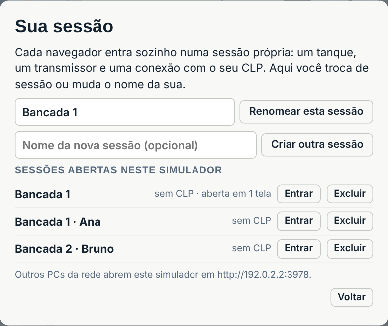

**Vários alunos:** o professor inicia o simulador em um PC e os alunos abrem pelo navegador, no endereço que aparece na janela do simulador e no rodapé da tela de sessões (por exemplo `http://192.168.0.15:3320`). Cada aluno cria a sua sessão: o tanque, o transmissor e a conexão com o CLP são só dele. O limite é de 60 sessões.

Confira: o chip **Sessão** mostra o seu nome e o chip do transmissor mostra `LT-01 10,40 mA · 13107`.

Para a cena 3D ocupar a tela toda, clique em **Ocultar painel**, no topo. Dentro das abas, cada seção tem um botão **ocultar/mostrar**; a tela lembra a sua escolha.

## Parte 2: no CODESYS, a rede passo a passo

O botão **Comunicação com o CLP**, no topo da tela, tem este mesmo roteiro com os programas prontos para copiar.

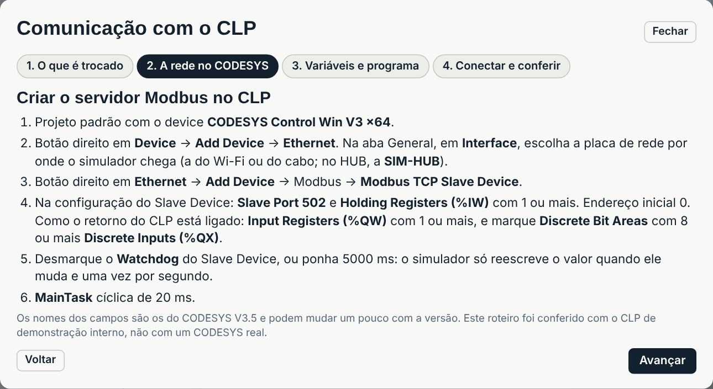

1. **File → New Project → Standard project**, device **CODESYS Control Win V3 x64**.
2. Botão direito em **Device** → **Add Device** → **Ethernet**. Na aba General, em **Interface**, escolha a placa de rede por onde o simulador chega: a do Wi-Fi ou do cabo em sala; no HUB, a **SIM-HUB (192.168.100.10)**.
3. Botão direito em **Ethernet** → **Add Device** → Modbus → **Modbus TCP Slave Device**. O CODESYS passa a ser o servidor.
4. Na configuração do Slave Device: **Slave Port 502** e **Holding Registers (%IW)** com 1 ou mais, endereço inicial 0. Só se for usar o retorno do CLP: **Input Registers (%QW)** com 1 ou mais, e marque **Discrete Bit Areas** com 8 ou mais **Discrete Inputs (%QX)**.
5. Desmarque o **Watchdog** do Slave Device, ou use 5000 ms. O simulador só reescreve o nível quando ele muda e uma vez por segundo.
6. **MainTask**: Cyclic, 20 ms. Em **Add Call**, primeiro `PRG_Modbus_IO`, depois o seu programa.

| Quem | IP | Papel |
| --- | --- | --- |
| CODESYS (CLP) | no HUB, **192.168.100.10** (o CODESYS na rede virtual SIM-HUB; o campo já vem com ele). Fora do HUB, o IP do PC onde o CODESYS roda | servidor Modbus TCP, porta 502 |
| Simulador | cliente, sem IP próprio | cliente Modbus TCP |

## Parte 3: as variáveis (GVL) e o mapeamento

Crie uma GVL chamada `GVL_SIM`. Os três arquivos também estão no cartão do HUB, em "Arquivos para o CLP".

```
(* GVL_SIM — uma variável por sinal, sem vetores. Os nomes são os mesmos da aba CLP do simulador.
   O PRG_Modbus_IO copia o %IW do "Modbus TCP Slave Device" para cá.
   As variáveis do bloco "retorno" só são lidas pelo simulador se a opção "Sinaleiros no painel (retorno do CLP)" estiver
   ligada na sessão. Se você vai usar os alarmes só dentro do CLP, o mapa inteiro é uma variável: LT01_Bruto. *)
VAR_GLOBAL
    (* ===== o simulador escreve, o CLP lê ===== *)
    (* entrada analógica                     Modbus holding  CODESYS *)
    LT01_Bruto  : INT;                    (* holding 0      %IW0     0..32767 = 4..20 mA = 0..100 %; negativo abaixo de 4 mA *)

    (* ===== retorno opcional: o CLP escreve, o simulador lê ===== *)
    (* sinaleiros do painel                  Modbus discrete CODESYS *)
    LALL_01     : BOOL;                   (* discrete 0     %QX0.0   alarme de nível muito baixo (H1)                        *)
    LAL_01      : BOOL;                   (* discrete 1     %QX0.1   alarme de nível baixo (H2)                              *)
    LAH_01      : BOOL;                   (* discrete 2     %QX0.2   alarme de nível alto (H3)                               *)
    LAHH_01     : BOOL;                   (* discrete 3     %QX0.3   alarme de nível muito alto (H4)                         *)
    Falha_LT01  : BOOL;                   (* discrete 4     %QX0.4   falha do transmissor ou do laço 4-20 mA (H5)            *)
    (* valor para a IHM                      Modbus input    CODESYS *)
    Nivel_Pct   : REAL;                   (* input 0        %QW0     nível em %, calculado no CLP (Modbus: x 100)            *)
END_VAR
```

O `PRG_Modbus_IO` copia cada endereço para a variável de mesmo nome, uma linha por sinal. Sem o retorno do CLP, só a linha do `LT01_Bruto` é necessária:

```
(* PRG_Modbus_IO — copia cada endereço do "Modbus TCP Slave Device" para a variável de mesmo nome da GVL_SIM, e de volta.
   Uma linha por sinal, na ordem da tabela da aba CLP. Chame no início da MainTask, antes do seu programa.
   Se o CODESYS mapear o dispositivo a partir de outro endereço (por exemplo %IW100), some esse início a todos os
   %IW/%QW (e o equivalente nos %QX). Confira os endereços na aba "Modbus TCP Slave Device I/O Mapping". *)
PROGRAM PRG_Modbus_IO

(* ===== entrada: holding register que o simulador escreve ===== *)
GVL_SIM.LT01_Bruto := WORD_TO_INT(%IW0);                       (* holding 0 *)

(* ===== retorno opcional: só é preciso com "Sinaleiros no painel (retorno do CLP)" ligado no simulador ===== *)
%QX0.0 := GVL_SIM.LALL_01;            (* discrete 0 *)
%QX0.1 := GVL_SIM.LAL_01;             (* discrete 1 *)
%QX0.2 := GVL_SIM.LAH_01;             (* discrete 2 *)
%QX0.3 := GVL_SIM.LAHH_01;            (* discrete 3 *)
%QX0.4 := GVL_SIM.Falha_LT01;         (* discrete 4 *)
%QW0 := INT_TO_WORD(REAL_TO_INT(GVL_SIM.Nivel_Pct * 100.0));   (* input 0, % x 100 *)
```

Se o CODESYS mapear o Slave Device a partir de outro endereço (veja a aba **Modbus TCP Slave Device I/O Mapping**), some esse início a todos os endereços.

## Parte 4: o programa em texto estruturado

Esta é a solução de referência. Tente escrever a sua antes de olhar.

```
(* PRG_Nivel — solução de referência: escala do LT-01, alarmes de nível com histerese e falha do transmissor.
   Usa só as variáveis nomeadas da GVL_SIM. Chame depois do PRG_Modbus_IO, na MainTask (cíclica, 20 ms).
   É o mesmo programa que o "CLP de demonstração" do simulador executa. *)
PROGRAM PRG_Nivel
VAR
    rPct   : REAL;            (* nível em %, 0..100 *)
    xFalha : BOOL;            (* transmissor em falha ou cabo rompido *)
END_VAR
VAR CONSTANT
    LIM_LL      : REAL := 10.0;     (* % *)
    LIM_L       : REAL := 20.0;
    LIM_H       : REAL := 80.0;
    LIM_HH      : REAL := 90.0;
    HISTERESE   : REAL := 2.0;
    BRUTO_FALHA : INT  := -410;     (* contagem de 3,8 mA: abaixo disso o transmissor está em falha ou o cabo rompeu *)
END_VAR

(* 1. escala: contagem do A/D (0..32767 = 4..20 mA) para % (0..100) *)
rPct := INT_TO_REAL(GVL_SIM.LT01_Bruto) / 32767.0 * 100.0;

(* 2. falha do transmissor: corrente abaixo de 3,8 mA (modo de falha "< 3,6 mA" ou cabo rompido) *)
xFalha := GVL_SIM.LT01_Bruto < BRUTO_FALHA;

(* 3. alarmes com histerese. Em falha, nenhum alarme de nível vale: o valor não é confiável *)
IF xFalha THEN
    GVL_SIM.LALL_01 := FALSE;
    GVL_SIM.LAL_01  := FALSE;
    GVL_SIM.LAH_01  := FALSE;
    GVL_SIM.LAHH_01 := FALSE;
ELSE
    IF rPct >= LIM_HH THEN GVL_SIM.LAHH_01 := TRUE; ELSIF rPct < LIM_HH - HISTERESE THEN GVL_SIM.LAHH_01 := FALSE; END_IF
    IF rPct >= LIM_H  THEN GVL_SIM.LAH_01  := TRUE; ELSIF rPct < LIM_H  - HISTERESE THEN GVL_SIM.LAH_01  := FALSE; END_IF
    IF rPct <= LIM_L  THEN GVL_SIM.LAL_01  := TRUE; ELSIF rPct > LIM_L  + HISTERESE THEN GVL_SIM.LAL_01  := FALSE; END_IF
    IF rPct <= LIM_LL THEN GVL_SIM.LALL_01 := TRUE; ELSIF rPct > LIM_LL + HISTERESE THEN GVL_SIM.LALL_01 := FALSE; END_IF
END_IF

(* 4. saídas: use onde quiser no seu CLP. O painel do simulador só as mostra com o retorno do CLP ligado *)
GVL_SIM.Falha_LT01 := xFalha;
IF xFalha THEN
    GVL_SIM.Nivel_Pct := 0.0;
ELSE
    GVL_SIM.Nivel_Pct := LIMIT(0.0, rPct, 100.0);
END_IF
```

| Bloco | O que faz | Por que é assim |
| --- | --- | --- |
| 1. Escala | Contagem → % | O cartão entrega 0–32767; quem dá sentido ao número é o programa |
| 2. Falha | `LT01_Bruto` < −410 | Abaixo de 3,8 mA o transmissor está em falha ou o cabo rompeu |
| 3. Alarmes | Liga no limite, desliga 2 % depois | Histerese evita o alarme piscando; em falha, nenhum alarme de nível vale |
| 4. Saídas | `Nivel_Pct` limitado a 0–100; 0 em falha | A IHM não deve mostrar um número em que ninguém pode confiar |

## Parte 5: testar

Na aba **CLP**, digite o IP do **seu** CLP e clique em **Conectar**. A tarja logo abaixo dos botões mostra o que aconteceu: amarela enquanto conecta, **verde "Conectado ao CLP"** com o último valor entregue, ou **vermelha "Não conectou"** com o motivo. Para ver os sinaleiros no painel 3D, ligue **Sinaleiros no painel (retorno do CLP)**. Com a chave desligada, confira os mesmos resultados nas variáveis da `GVL_SIM`, online no CODESYS.

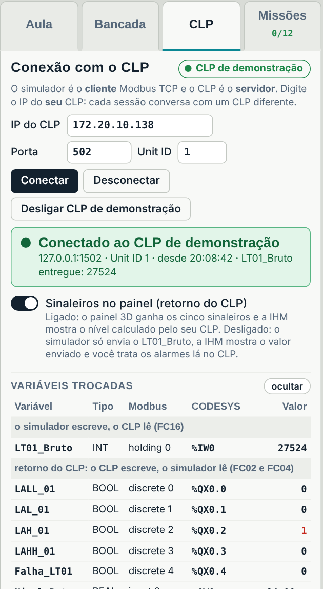

| Ação na Bancada | O que deve acontecer |
| --- | --- |
| Nível em 1,00 m | `LT01_Bruto` = 13107; `Nivel_Pct` = 40,00 %; nenhum sinaleiro |
| Nível em 2,10 m | 84 %: acende **LAH** |
| Nível em 2,30 m | 92 %: acendem **LAH** e **LAHH** |
| Nível em 0,20 m | 8 %: acendem **LAL** e **LALL** |
| Espuma em 95 % e esperar 4 s | E013, 3,55 mA, `LT01_Bruto` = -922: acende **FALHA**, apagam os de nível |
| Romper o cabo do laço | `LT01_Bruto` = -8192: acende **FALHA** |

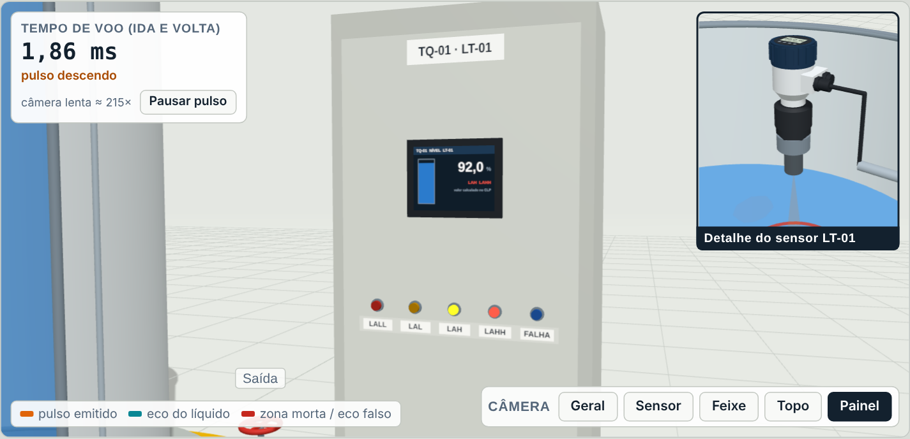

## Vários alunos, fila e varredura

- Cada sessão tem a sua conexão. Se dois alunos tentarem o mesmo IP e porta, o segundo é recusado e a tela diz quem já está lá.
- A troca com o CLP é **uma requisição de cada vez**, com 10 ms entre frames, por uma fila com prioridade. Pedidos repetidos se fundem: nunca se acumula valor velho.
- Escrita do nível só quando muda mais que 8 contagens, no máximo a cada 200 ms. A cada 1 s o valor é reenviado.
- Leitura dos sinaleiros e da IHM a cada 250 ms, **só com o retorno do CLP ligado**.
- Sem retorno: no máximo 6 requisições por segundo por CLP, e 1 por segundo com o nível parado. Com retorno: no máximo 14, e cerca de 9 com o nível parado.
- Se o CLP demorar mais de 200 ms em média, a varredura fica 3 vezes mais lenta até ele se recuperar.
- Se a conexão cair, o simulador apaga os sinaleiros e a IHM e tenta de novo a cada 5 s.

## Missões

Na aba **Missões** há dez tarefas, da comunicação até a armadilha do 22 mA. Elas fecham sozinhas quando o seu CLP faz o que foi pedido. As de alarme leem os sinaleiros do CLP, então precisam do **retorno do CLP ligado**. Com o CLP de demonstração elas acendem, mas não ficam gravadas.

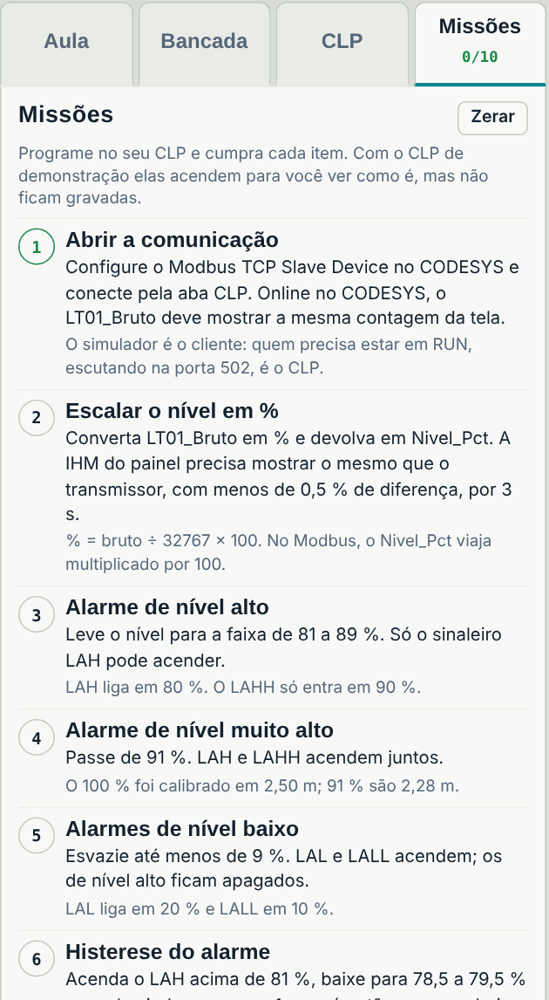

## Sem CLP

- Aba **Aula**: oito passos guiados, cada um com um botão que monta a experiência.
- Aba **CLP** → **Ligar CLP de demonstração**: um CLP interno, só da sua sessão, roda o programa de referência. Serve para ver os sinaleiros e a IHM funcionando antes de programar.

## Instalar fora do HUB

1. Extraia o .zip em uma pasta.
2. Clique duas vezes em `INSTALAR.bat` (instala o Node.js se faltar e cria o atalho). Responda **S** para liberar a porta 3320 no firewall se outros PCs forem abrir a tela.
3. Clique duas vezes em `INICIAR_SIMULADOR.bat`. A janela preta mostra o endereço para os outros PCs.
4. Para conferir a instalação: `TESTAR.bat` deve terminar com "0 falha(s)".

## Problemas comuns

| Sintoma | Causa provável | Solução |
| --- | --- | --- |
| "recusou a conexão na porta 502" | CLP em STOP, sem o Slave Device, ou IP de outra placa | Ponha em RUN; confira a Interface do nó Ethernet e o IP digitado |
| "sem resposta de ...: confira o IP" | IP errado, firewall do Windows ou PCs em redes diferentes | Teste com ping; libere a porta 502 no PC do CLP |
| "já está conectada em ..." | Outro aluno usou o mesmo IP | Cada aluno usa o IP do próprio PC |
| "não tem esse endereço" | Áreas do Slave Device menores que o mapa | 1 holding register; com o retorno ligado, também 1 input register e Discrete Bit Areas com 8 discrete inputs |
| Painel 3D sem sinaleiros | Retorno do CLP desligado na sessão | Aba CLP → ligue **Sinaleiros no painel (retorno do CLP)** |
| Conectado, mas nada acontece no CLP | O simulador só sabe que a conexão está aberta, não se o seu programa está rodando | Confira online no CODESYS se o CLP está em RUN e se o `LT01_Bruto` muda |
| `LT01_Bruto` volta a 0 sozinho no CODESYS | Watchdog do Slave Device zerando as entradas | Desmarque o Watchdog ou use 5000 ms |
| IHM mostra 0,4 em vez de 40 | Faltou multiplicar por 100 no `%QW0` | `REAL_TO_INT(Nivel_Pct * 100.0)` |
| FALHA acende com o tanque vazio | Comparação com 0 em vez de −410 | Falha é só abaixo de −410 |
| Faixa vermelha no topo: "a tela é da versão X, mas o programa... é da versão Y" | Os arquivos foram trocados com o simulador aberto | Feche o simulador (janela preta ou cartão do HUB) e abra de novo |
| Tela 3D não aparece | WebGL desligado no navegador | Use Chrome ou Edge atualizados; o resto da tela funciona |
| Outros PCs não abrem a tela | Firewall bloqueando a porta 3320 | Rode o `INSTALAR.bat` e responda S, ou libere a porta à mão |

## O que é modelo didático

- Os dados técnicos (zona morta 0,25 m, 70 kHz, feixe de 11°, faixa de 5 m, modos de falha, E013 e E017) e as cotas do sensor em 3D vêm do manual de operação (28775) e da folha de especificação (34584) do VEGASON 61. O acabamento do sensor em 3D é genérico. Simulador independente, sem vínculo com o fabricante.
- A escolha do eco ("primeiro eco acima do limiar"), as amplitudes da curva e os 4 s até o E013 são um modelo simplificado. O aparelho real mede a cada 2 s ou mais e usa processamento próprio.
- A correção de temperatura é fixa no aparelho real; a chave existe só para mostrar o erro.
- O roteiro do CODESYS e os programas ST foram conferidos contra o CLP de demonstração interno e os testes automáticos, **não em um CODESYS real**. Os nomes dos campos são os do CODESYS V3.5 e podem variar com a versão.
